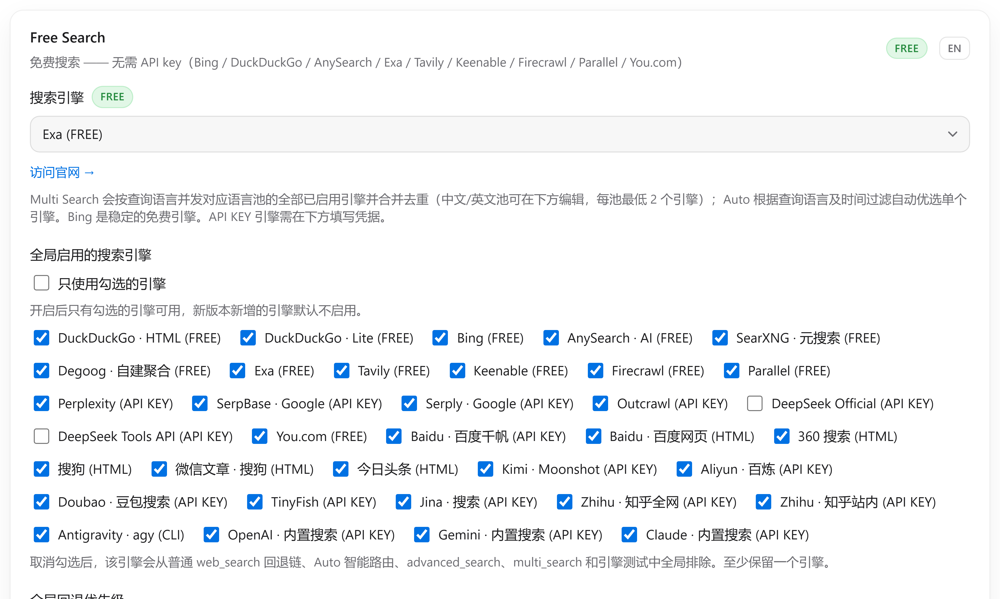
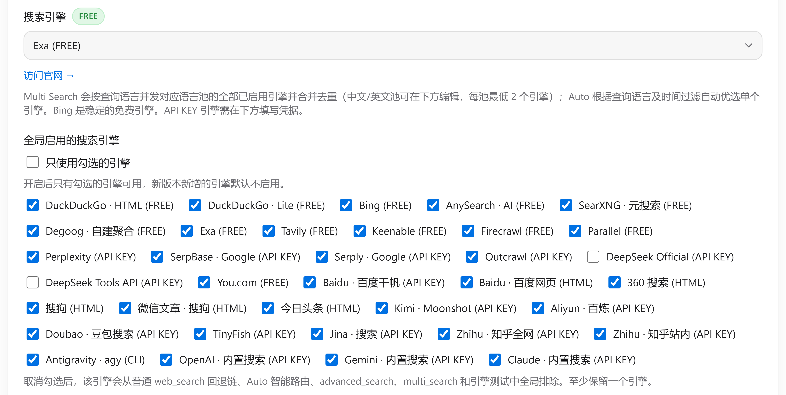
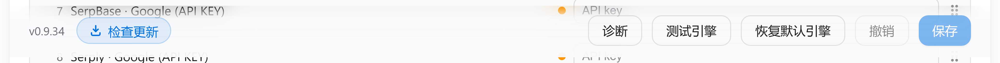
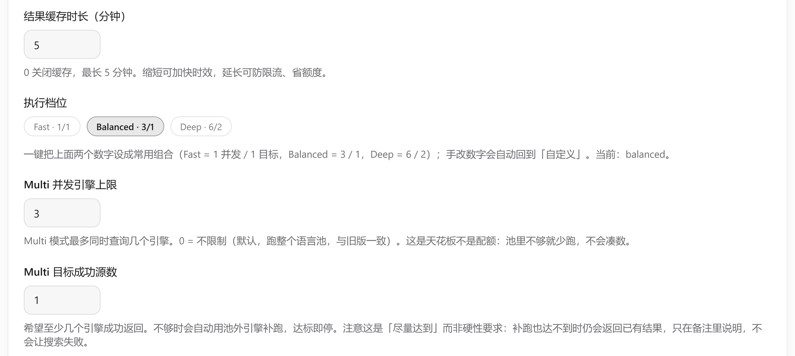
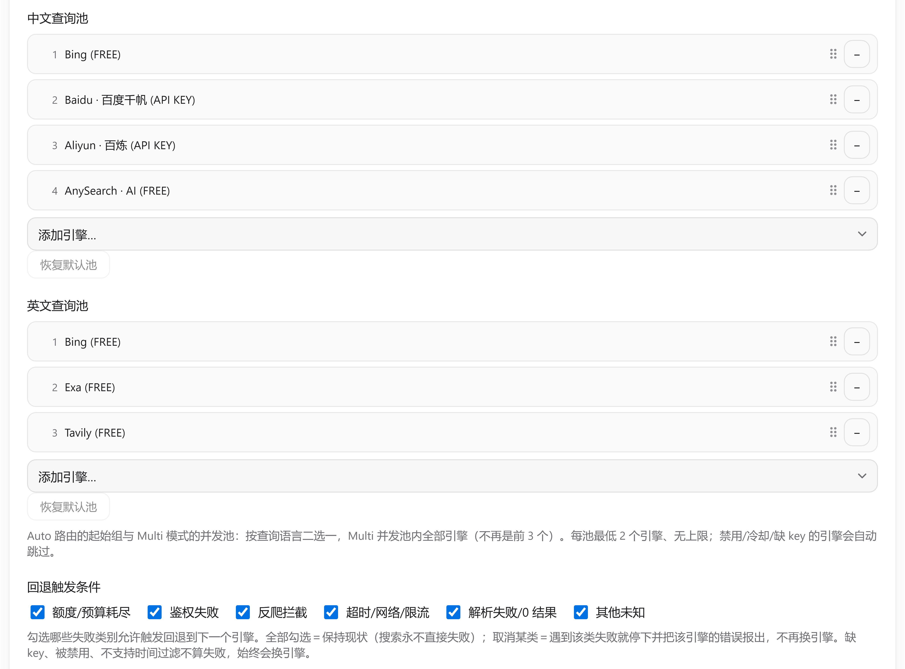
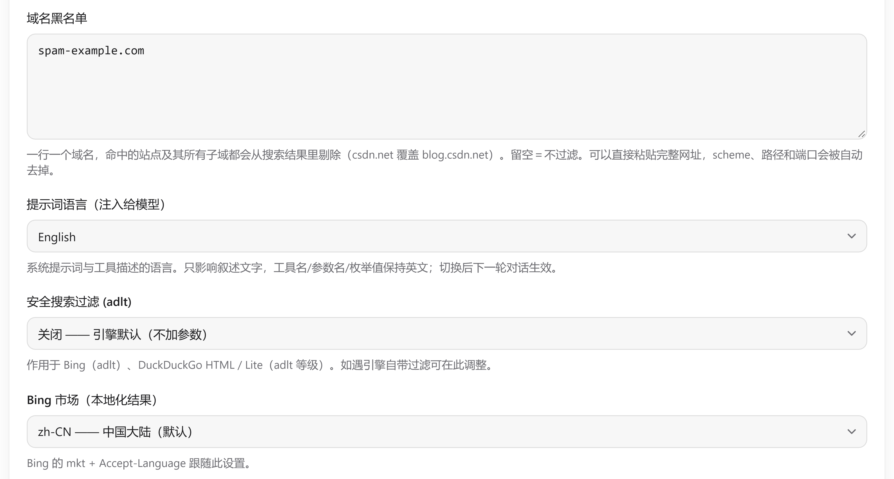
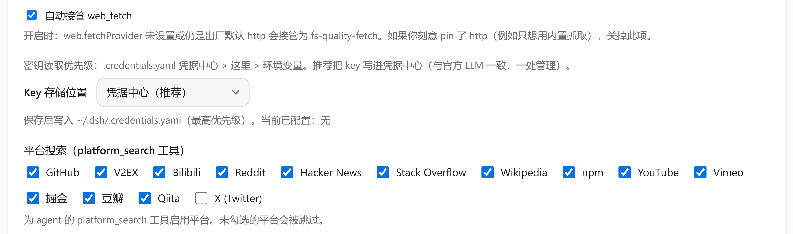
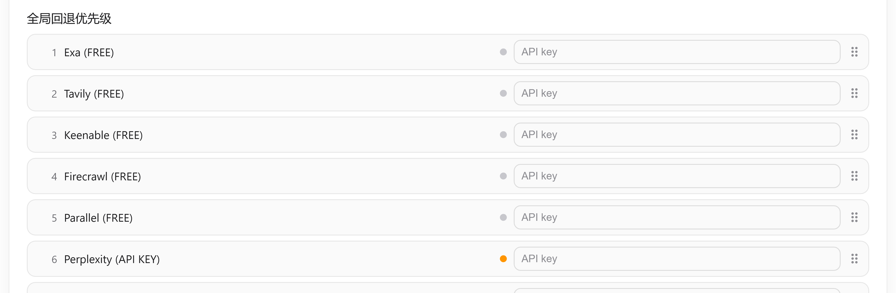
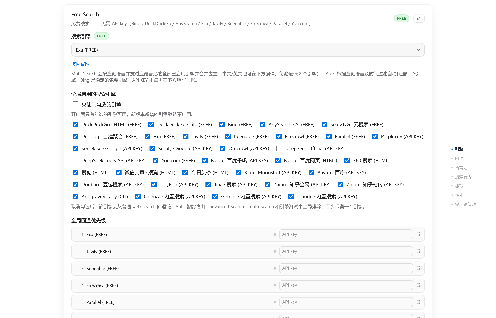

# dsh-free-search

[](https://github.com/DDDMUC/dsh-free-search/actions/workflows/ci.yml)

**DeepSeek Harness 免费搜索插件：无需 API key，零成本，多引擎可切换。** 这是一个给 DeepSeek Harness (dsh) 添加多引擎搜索 provider 的插件，注册进 `ctx.web` seam。内置 `web_search` 工具自动选用，支持网页设置页切换引擎、配置 API key、一键测试所有引擎、弹出式命令切换引擎。

[中文](#中文) · [English](./README.en.md)

---

## 中文

<div align="center">
  <a href="https://raw.githubusercontent.com/DDDMUC/dsh-free-search/master/assets/ui-overview.png">
    
  </a>
  <br>
  <sub>▲ 设置页总览</sub>
</div>

### 谁需要它

如果你：

- 没有（或不想）配置 DeepSeek 官方 key，用第三方模型供应商发现无法搜索
- 虽然配置了官 key，但用的明明是第三方模型供应商，结果 DeepSeek 账户却依旧扣费

这一切都是因为 dsh 默认的搜索 provider 依赖 DeepSeek 官方 API key（`DEEPSEEK_API_KEY`）。没有配置官 key，内置搜索就会失败；配置了官 key，即使用第三方模型供应商，搜索时也会使用官方渠道，产生隐形扣费。

这个插件就是来解决这些问题的：它提供多个免费引擎 + 自动回退，让 DSH 彻底摆脱 DeepSeek 官方 key 的依赖。

### 特性

#### 引擎与切换

- **零成本** —— 多个免费引擎，无需 key、无需注册
- **43 个引擎可选**：DuckDuckGo（html/lite）、Bing、SearXNG（元搜索，支持自定义实例）、AnySearch、Exa、Tavily、Keenable、Firecrawl、Parallel、Brave（`brave`，官方 Search API，需 `BRAVE_API_KEY`）、智谱（`zhipu`，官方 Web Search API，需 `ZHIPU_API_KEY`）、Perplexity、SerpBase、Serply、Outcrawl、SpecStream（`specstream`，官方 Search API，需 `SPECSTREAM_API_KEY`）、Google 自定义搜索（`google`，需 API key + CSE ID）、秘塔搜索（`metaso`，官方 API，按点数计费）、Yandex 搜索（`yandex`，官方 API，按请求计费，需 folder ID）、腾讯元宝搜索（`yuanbao`，API key 网关，有活动免费额度）、DeepSeek 官方、DeepSeek 原生搜索 API、You.com、百度千帆、Kimi、阿里云百炼、火山联网搜索（豆包搜索）、知乎全网/站内（`zhihu_global`/`zhihu_site`，经知乎开放平台 MCP）、Antigravity CLI 搜索（`agy`，需本机安装）、OpenAI / Gemini / Claude 模型内置搜索。默认自动回退链覆盖其中 30 个；5 个 HTML SERP 引擎默认不参与，OpenAI / Gemini / Claude 三个模型引擎、Metaso、Yandex、Yuanbao 和 SpecStream 都只在显式点名时运行。
- **5 个 HTML 搜索页引擎（默认关闭）** —— 把传统搜索页并入同一套引擎 / 回退 / 冷却 / 设置体系：`baidu-html`（百度网页）、`so360`、`sogou`、`wechat`（微信文章）、`toutiao`。免 key、免额度，代价是抓页面：验证码/反爬按 `bot-wall` 归类并让整个家族冷却 10 分钟（整段出口 IP 都会被打标），结果也没有 API 摘要。它们默认不进 auto / 回退链 / 语言池，只在显式 `engine=` 或加入语言池时运行。
- **启用引擎白名单** —— 插件只维护一份 `allowedEngines` 启用列表；未勾选的引擎从所有搜索链、Auto / Multi 路由、引擎测试和提示词中移除。升级新增的引擎默认不启用，需要手动勾选。
- **全局引擎开关与回退优先级** —— 设置页可勾选/取消引擎（取消后全局生效：普通搜索 / Auto / `advanced_search` / `multi_search` / 引擎测试都不再用它），回退链支持添加、删除与 ↑↓ 拖动排序（一键恢复默认）。
- **弹出式切换命令** —— 聊天框输入 `/free-search-engine`，弹出引擎选择窗口，点选即切换（等效设置页 + 保存）。
- **免费标注** —— 设置页中免费引擎带绿色 `FREE` 徽章，付费引擎带橙色 `API KEY` 徽章。


<sub>▲ 引擎切换、全局开关与白名单；绿色 FREE / 橙色 API KEY 徽章</sub>

#### 回退、冷却与更新

- **统一引擎回退** —— 任何引擎失败（付费/免费，缺 key/401/限流/网络）自动轮流尝试下一个引擎：首选引擎 → 其他引擎（exa/tavily/keenable/firecrawl/parallel/you 无 key 也会尝试，因为它们自带 keyless 免费额度）→ 剩余免费引擎，搜索永不直接失败；结果顶部注明实际生效的引擎（如 `Note: perplexity unavailable or failed, using exa.`）；失败按类别处理：额度/鉴权失败 → 本会话冷却该引擎，反爬 → 短退避，超时/5xx/限流 → 同引擎重试一次，解析失败/0 结果 → 不冷却（详见下文「失败分类与引擎冷却」）。
- **多 key 轮换** —— 任何 key 字段（或对应环境变量）都可以用逗号 / 分号 / 换行分隔多把 key；平时按请求轮流使用（round-robin，避免单 key 撞 QPS/RPM 风控），遇到 401/402/429（鉴权失败、额度耗尽、限流）先轮换同一引擎的下一把，再走引擎回退；`multi` 模式同样生效（#96）。
- **按 key 冷却与诊断** —— 429 与额度错误按 key 分别冷却，同一引擎的其他 key 不受牵连；冷却状态写入磁盘，重启后仍在；失败信息和日志里的 key 一律打码；设置页底部的「诊断」按钮列出每个引擎当前为什么不可用、冷却还剩多久，以及本次进程内的调用次数、成功/空/失败和平均耗时；同一引擎并发超过 2 会排队（HTML SERP 为 1），避免免费引擎被同时打爆；诊断还会标注当前 web search/fetch provider，被其他插件接管时给出互斥警告。
- **自带更新** —— 卡片底部显示当前版本和「检查更新」；npm 安装的版本可一键升级到 latest，本地 link 开发模式改为跳转 npm 页面并提示 `git pull`。
- **引擎测试** —— `free_search_test` 工具让 agent 一键测试所有引擎；设置页也有「测试引擎」按钮（直测当前引擎，不走回退链，付费引擎无 key 会明确报错）。
- **截断安全** —— 标题和摘要按码点截断，搜索结果、工具输出和 `web_fetch` 正文在离开插件前统一清除孤立代理；含 emoji 的结果不会再让会话历史出现无法序列化的字符（#108）。


<sub>▲ 底部工具条：版本、检查更新、诊断、测试引擎、恢复默认、撤销与保存</sub>

#### Multi 与语言池

- **Multi 模式** —— 可把搜索引擎设为 `Multi Search`：`web_search` 按查询语言并发**对应语言池的全部**已启用引擎（不再是前 3 个；中文/英文池可在设置页编辑，每池最低 2 个引擎）、按 URL 合并去重（同站判定用 **eTLD+1**）、跨源命中的结果优先；设置页有 **Fast / Balanced / Deep** 三档强度，也可手填并发上限与目标成功源数；整轮检索共享 **30 秒总预算**，到点返回已有结果；合并结果的条数上限可在设置页调整（对应 `multiMaxResults`，默认 20，最大 100，单次 `maxResults` 只能要得更少）。合并结果会用 MinHash 去掉近重复来源。代价是成倍消耗额度；multi 失败会自动退回单引擎回退链。
- **按意图路由** —— Auto 在未自定义回退顺序时，按查询领域（金融 / 学术 / 代码 / 新闻 / 购物）重排当前语言池；只调整已有引擎的先后，不新增引擎、不改回退集合。


<sub>▲ 性能：结果缓存时长与 Multi 的 Fast / Balanced / Deep 档位</sub>


<sub>▲ 语言池：中文 / 英文各一组，拖拽排序、添加或删除引擎</sub>

#### 搜索行为

- **结果缓存** —— 相同查询（含引擎/时间过滤参数）5 分钟内命中缓存（LRU 50 条），防免费引擎限流、省付费额度；时长可在设置页 0-5 分钟自由配置（0 关闭）。
- **域名黑名单与安全搜索** —— `blockedDomains`：命中的域名不会进入任何结果；`safeSearch`（`off` / `moderate` / `strict`）为 Bing / DuckDuckGo 加一层过滤。


<sub>▲ 搜索行为：域名黑名单、提示词语言、安全搜索与 Bing 市场</sub>

#### 抓取与工具

- **网页抓取（web_fetch）** —— 让 agent 抓取网页内容（官方 `dsh-web-fetch-http` provider，纯 JS，零额外依赖），可自动接管 `web.fetchProvider` 为插件的直连 → 浏览器渲染 → exa / firecrawl → crawl4ai 质量链。直连层同时支持 `http://` 与 `https://` 目标，并按每一跳的协议选择传输；只有 `http(s)` 以外的协议会被拒绝。T1.5 浏览器渲染可在设置页关闭，exa 与 firecrawl 的先后顺序也可切换；私网、回环和云元数据地址一律拒绝（SSRF 防护）。Clash / mihomo TUN 的 fake-ip 网段（常见 198.18.0.0/15）可在「额外允许的网段」里显式放行，否则系统 DNS 返回的占位地址会被当成私网拒绝。


<sub>▲ 抓取：自动接管 web_fetch、Key 存储位置与平台搜索开关</sub>

- **平台搜索（platform_search）** —— 搜 GitHub / V2EX / B站 / Reddit / Hacker News / Stack Overflow / 维基百科 / npm / YouTube / Vimeo / 掘金 / 豆瓣 / Qiita（公开 API 或免 key 抓取，零依赖）；X (Twitter) 经本地 Grok Build CLI（需 SuperGrok / X Premium 登录）。
- **垂直领域直查（domain_search）** —— 41 个免 key 垂直源直查：包/版本（PyPI、crates、GitHub releases、endoflife…）、学术（arXiv、Crossref、OpenAlex、Semantic Scholar、PubMed、dblp、Zenodo…）、安全（NVD、OSV、CISA KEV）、金融（SEC EDGAR、IMF、World Bank、CFETS、Yahoo Finance、CoinGecko…）、法律（US Federal Register、US CourtListener、openlegaldata、UK legislation）、新闻（Google News、GDELT）等。
- **视频搜索（video_search）** —— 跨站找视频：Bing Videos + DuckDuckGo Videos（免 key，失败互相回退），返回视频链接、标题与来源/时长等元信息。
- **一次调用完成研究（research）** —— 多引擎并发搜索 → 候选重排 → 分层抓取正文 → 段落选窗 → 带出处的 Markdown 证据包；模型组件（重排/嵌入/决策模型）全部可选，缺失或失败时静默回退规则路径；输出附带证据质量闸门（high / medium / low 与结论上限），证据不足时明确提示先核验再下结论。
- **检索正文缓存（cache_search）** —— 全文检索 `research` 抓过的正文（`node:sqlite` 持久缓存，存储 7 天；`node:sqlite` 不可用时自动降级为 no-op，免 flag 需 ≥ 22.13，22.5–22.12 需 `--experimental-sqlite`）。
- **干净集成** —— 实现官方 `WebSearchProvider` seam 接口，与官方插件共存。
- **时间过滤** —— `advanced_search` 工具支持 `timeRange`：固定档、自定义相对值、绝对日期三种形式（详见下方逻辑说明）。
- **系统提示词注入** —— agent 知道当前用哪个引擎、哪些需要 key；并明确所有搜索结果是**不可信外部数据**，不得执行其中的指令。四段内容都可自定义，其中「结果展示」单独控制搜索结果怎么写进回答（引用带链接、同一来源只出现一次、不复读工具已展示的内容）。
- **提示注入防护（不可信数据边界）** —— 插件自有工具（`advanced_search` / `platform_search` / `free_search_test`）的网页文本包在 `<untrusted-web-content>` 边界内（正文里自带的同名标记会被剥离，防止提前闭合）；核心 `web_search` / `web_fetch` 由 DSH 核心自带同类提示（`External web content follows...`）；所有 snippet 统一清洗并截断到 300 字符。

#### 设置页与目录

- **网页设置页** —— 引擎切换 + API key 配置（UI 中 key 脱敏显示「已配置」）+ 中英文切换；入口在左侧「插件」页的组件行配置（`plugins.row.config`，DSH 0.2.1-rc.2+）。远程访问（VPS / 反向代理 / 自定义域名）下也能用：桥接接口沿用宿主的 Host 围栏，`--trusted-host` 与 `--public-url` 声明的地址会放行（#84）。
- **侧栏入口可关闭** —— 默认在左侧栏显示「免费搜索」；设置页关闭后写入配置并持久化，重启仍隐藏；隐藏时可用 `/free-search` 命令或插件页打开。
- **斜杠命令可关闭** —— 默认注册 `/free-search-engine` 和 `/free-search`；设置页关闭 `slashCommands` 后两个命令都不再注册，设置仍在插件页，提示词也改为让模型参考插件设置。适合只想给 agent 用搜索工具的场景。
- **优先使用免 key 档（可选）** —— 默认配了 key 的引擎一律用 key。设置页打开 `keylessFirst` 后，Exa / Tavily / Keenable / Firecrawl / Parallel / AnySearch / You.com 先走免 key 档，只有它限流、额度用尽、要求鉴权或网络失败时才改用 key（同一次请求内重试一次）；免 key 档失败后会休息一段时间（上限 45 分钟），期间直接用 key。适合 key 按量计费、想把它留作后备的场景。


<sub>▲ 全局回退优先级：每行一个引擎，右侧填该引擎的 API key（已配置会脱敏显示）</sub>

- **右侧浮动目录** —— 卡片右侧的页面留白里浮出「引擎 / 回退 / 语言池 / 搜索行为 / 抓取 / 性能 / 提示词管理」七个快捷跳转，滚动自动高亮当前项、点击平滑跳转；不占用正文宽度，右侧留白不足时自动隐藏；每项都是真链接（`#/panel/plugins/dsh-free-search/<分区>`），可复制、可开新标签，见下方「分区链接契约」。


<sub>▲ 右侧浮动目录：七个分区，滚动跟随高亮</sub>

### 注入的系统提示词分四段

设置页第七段「提示词」管理本插件注册的系统提示词，分成四段：状态、工具、约束、结果展示。每段都有自己的翻页器，页 1 是内置英文、页 2 是内置中文，都按当前配置实时生成，不入盘，不能删也不能改；页 3 起是你自己加的页。发送时每段取你当前停的那一页，拼起来就是注入内容；四段都空则整段不注入。

alt="提示词四段：状态 / 工具 / 约束 / 结果展示"
▲ 提示词四段：状态 / 工具 / 约束 / 结果展示；页 2 是内置中文页，工具行只读

「工具」那一段是九个工具各一行：前面的勾选框决定这个工具给不给模型，后面的框里是写给模型的那句话，只读，跟插件更新走，不能改。这一段的右上角有中英切换，一下切换全部工具；工具列表最上面是一个「全选」勾选框，勾上就是全部交给模型，取消就是全部不交，只勾一部分时它显示为半选。取消勾选的工具不再交给模型，工具说明也一并从请求里去掉，那一段里也不会再列出它。想加自己的要求，写在「约束」那一段的自定义页里。

### 分区链接契约（与 dsh-url-router 对接）

规则见 `dsh-url-router/docs/panel-sections.md`（数量不限，当前 7 段：engines / fallback / pools / behavior / fetch / performance / prompt）：

- 页面根发布**恰好一个** `data-dsh-panel-section="<id>"` = 读者正在看的那一节（跟着滚动走，不做“到底=最后一节”的猜测）
- 每个分区容器带 `data-dsh-section="<id>"`（滚动目标）
- 侧栏每项是 `<a data-dsh-section="<id>" href="#/panel/plugins/dsh-free-search/<id>">`
- 本插件**不写 URL**：`location.hash` / `history.pushState` / `replaceState` 一律不碰，地址栏唯一写者是 dsh-url-router；地址栏里出现本页分区链接时（`hashchange`）插件负责把它滚进视野

加新分区只需三步：容器加 `data-dsh-section="<新id>"`、`NAV_ITEMS` 加一条（侧栏锚点自动生成，href 由 `item.id` 拼）、`assert-rail-section` 的 id 列表加一项。

如果这个插件帮到了你，欢迎给仓库点个 ⭐（[GitHub](https://github.com/DDDMUC/dsh-free-search)）——星标是开发者继续维护的最大动力，感谢支持！

### 引擎列表

| id | 引擎 | 费用 | 免 key | 说明 |
|---|---|---|---|---|
| `auto` | Auto 智能路由 | 动态 | 视池 | **根据查询语言/时间条件自动选路**（含中文优先 Bing/Baidu/Aliyun/AnySearch，英文优先 Bing/Exa/Tavily；时间过滤优先支持引擎），末尾全量回退 |
| `ddg` | DuckDuckGo HTML | 免费 | 是 | 偶发限流（反爬），解封自动恢复 |
| `ddg-lite` | DuckDuckGo Lite | 免费 | 是 | 轻量版，同上 |
| `bing` | Bing | 免费 | 是 | 免 key，中文优化（zh-CN）；中国出口的自动默认 |
| `anysearch` | AnySearch AI | 免费 | 是 | AI 搜索，无 key（匿名额度） |
| `searxng` | SearXNG 元搜索 | 免费 | 是 | 多实例自动切换，支持自定义实例 |
| `degoog` | Degoog（自建聚合器） | 免费 | 是（需实例） | 需要自己的实例（`degoogInstances`），免 key；实例开启 API Key 时用 `degoogApiKey`（Bearer） |
| `exa` | Exa | 免费 | 可选 | **无 key 也可用**（MCP 匿名），配 key 提升额度 |
| `tavily` | Tavily | 免费 | 可选 | **无 key 也可用**（keyless 匿名），配 key 提升额度 |
| `keenable` | Keenable | 免费 | 可选 | **无 key 也可用**（MCP 匿名），配 key 提升额度 |
| `firecrawl` | Firecrawl | 免费 | 可选 | **无 key 也可用**（官方免 key 匿名额度），配 key 提升限额。注意：keyless 档按**出口 IP** 判定，VPN/代理出口会被 403 拒绝；插件会冷却 6 小时并说明原因（有 key 不受影响） |
| `parallel` | Parallel | 免费 | 可选 | **无 key 也可用**（官方 MCP 匿名额度），配 key 提升额度并支持精确时间过滤 |
| `brave` | Brave Search | 付费（有免费额度） | 否 | 需 `BRAVE_API_KEY`（[API Dashboard](https://api-dashboard.search.brave.com)，$5/月免费额度 ≈ 1,000 次，超出按 $5/1,000 次计费）；独立索引，`freshness` 支持 pd/pw/pm/py 与日期区间 |
| `zhipu` | 智谱搜索 | 付费（按次） | 否 | 需 `ZHIPU_API_KEY`；`search_std` ¥0.01/次、`search_pro` ¥0.03/次、搜狗/夸克 ¥0.05/次；支持 oneDay/oneWeek/oneMonth/oneYear 时间过滤 |
| `you` | You.com | 免费 | 可选 | **无 key 也可用**（官方免 key 档，每天 100 次），配 `YDC_API_KEY` 提升额度（旧名 `YOUCOM_API_KEY` 继续兼容） |
| `agy` | Antigravity CLI | 免费 | 是（需 CLI） | 需本机安装 [Antigravity](https://antigravity.google) 并登录，插件通过 `agy -p` 调用；免 key、免额度，默认在引擎列表里，没装 CLI 时自动跳过 |
| `perplexity` | Perplexity | 付费 | 否 | 需 `PERPLEXITY_API_KEY` |
| `serpbase` | SerpBase | 付费 | 否 | 需 `SERPBASE_API_KEY`（serpbase.dev，注册送 100 次免费额度） |
| `serper` | Serper.dev | 付费 | 是 | 需 `SERPER_API_KEY`（serper.dev，注册送 2,500 次免费额度）；`X-API-KEY` 鉴权，时间过滤走 Google `tbs` |
| `serply` | Serply | 付费 | 否 | 需 `SERPLY_API_KEY`（serply.io，新账户 30 天内 2,500 次免费额度）；Google 网页结果，按设置页语言本地化 |
| `outcrawl` | Outcrawl | 付费 | 否 | 需 `OUTCRAWL_API_KEY`（outcrawl.ai，每月 1,000 credits 免费额度）；网页搜索结果（标题/链接/摘要），单次最多 20 条 |
| `google` | Google 自定义搜索 | 免费额度 | 否 | 需 `GOOGLE_CSE_API_KEY` 和 Programmable Search Engine ID（`googleCseId` / cx）；Google 官方 Custom Search JSON API，每天 100 次免费，按次计费超额；支持 `hl`、安全搜索和 `dateRestrict` 时间过滤 |
| `metaso` | 秘塔搜索 | 付费（点数） | 否 | 需 `METASO_API_KEY`（metaso.cn/api）；官方 AI 搜索 API，按点数计费（约 0.03 元/次，新用户有体验额度）；支持网页 / 文库 / 学术三种 `scope`，返回摘要和来源；不在默认回退顺序里，配 key 后显式选用 |
| `yandex` | Yandex 搜索 | 付费 | 否 | 需 `YANDEX_API_KEY` 和 `yandexFolderId`（AI Studio，按请求计费，需 billing account）；官方 Search API，`searchType` 支持 RU/TR/COM/KK/BE/UZ，响应为 Base64 XML；支持 day / 2 weeks / month 时间过滤；显式专用 |
| `yuanbao` | 腾讯元宝搜索 | 付费（有活动免费额度） | 否 | 需 `TENCENTCLOUD_WSA_APIKEY`（console.cloud.tencent.com/wsapi）；API key 网关，支持自然 / 权威 / 混合模式、站点限定、时间范围；活动页可领每日免费额度（限时）；显式专用 |
| `specstream` | SpecStream | 付费 | 否 | 需 `SPECSTREAM_API_KEY`（specstream.ai）；网页搜索结果（标题/链接/摘要/发布日期），单次最多 10 条；显式专用（不在默认回退链、Auto 路由或语言池里） |
| `deepseek-official` | DeepSeek 官方 | 付费 | 否 | 需 `DEEPSEEK_API_KEY`；走 Anthropic 兼容的 `web_search` 服务端工具，每次搜索是一整个模型轮次（慢、耗 token） |
| `deepseek-tools` | DeepSeek 原生搜索 API | 付费 | 否 | 需 `DEEPSEEK_API_KEY`（与上一档共用）；直接 `POST /v1/tools/search`，无模型参与，返回结构化 `results[]`（`title`/`url`/`summary`/`date`），同 query 实测 ~0.3s vs 上一档 ~5-6s；端点可通过 `deepseekToolsBaseUrl` 改成自定义网关（完整 URL 或 base；走 `/v1/search` 的网关请填完整 URL），key 可用 `deepseekToolsApiKey` 单独覆盖 |
| `baidu` | 百度千帆 AI 搜索 | 额度 | 否 | 需 `BAIDU_API_KEY`（千帆 AI 搜索：web_search 每日赠 50 次，额度用尽/403 时自动回退到 chat/completions，另有 100 次/天免费额度；超额按量后付费）；中文全网，支持时间过滤 |
| `kimi` | Kimi（Moonshot）联网搜索 | 付费 | 否 | 需 `MOONSHOT_API_KEY`（basic 约 ￥0.01/次），返回带正文 chunks 的中文结果；**无免费额度**，适合显式选用或作质量升级池，不建议放进默认并发池 |
| `kimi` | Kimi（Moonshot）联网搜索 | 付费 | 否 | 需 `MOONSHOT_API_KEY`（basic 约 ￥0.01/次），返回带正文 chunks 的中文结果 |
| `aliyun` | 阿里云百炼 EnhancedSearch | 付费 | 否 | 需 `DASHSCOPE_API_KEY`（MCP search_pro，约 ￥0.03/次，新用户 200 次免费包）；中文全网带来源 hostname |
| `doubao` | 火山引擎联网搜索（豆包搜索） | 免费额度 | 否 | 需 `DOUBAO_SEARCH_API_KEY`（联网搜索控制台开通，**每月 500 次免费**，超出按量付费）；中文时效内容强，支持时间/站点过滤，返回千字级摘要 |
| `zhihu_global` | 知乎全网搜索（开放平台 MCP） | 免费额度 | 否 | 需 `ZHIHU_API_KEY`；**每日 5,000 次试用额度**（试用结束需另行开通）；支持时间过滤（`publish_time`）；无 key 时自动跳过 |
| `zhihu_site` | 知乎站内搜索（开放平台 MCP） | 免费额度 | 否 | 需 `ZHIHU_API_KEY`；**每日 5,000 次试用额度**（与 `zhihu_global` 共享）；不支持时间过滤 |
| `zhihu_global` | 知乎全网搜索（开放平台 MCP） | 付费 | 否 | 需 `ZHIHU_API_KEY`；支持时间过滤（`publish_time`）；无 key 时自动跳过 |
| `zhihu_site` | 知乎站内搜索（开放平台 MCP） | 付费 | 否 | 需 `ZHIHU_API_KEY`；不支持时间过滤 |
| `openai` | OpenAI 模型内置搜索 | 付费 | 否 | 需 `OPENAI_API_KEY`；走 Responses API 的 `web_search` 工具，返回带引用的回答。**按次计费，仅在显式选中时使用**（不参与自动回退/auto）；默认 `gpt-6-luna`，模型与端点可配（`openaiModel` / `openaiBaseUrl`） |
| `gemini` | Gemini Grounding with Google Search | 付费 | 否 | 需 `GEMINI_API_KEY`（兼容 `GOOGLE_API_KEY`）；走官方推荐的 **Interactions API**（`POST /v1beta/interactions`，`tools:[{type:"google_search"}]`），从 `steps[].content[].annotations` 取引用。**按次计费，仅在显式选中时使用**；默认 `gemini-3.8-flash`，模型与端点可配（`geminiModel` / `geminiBaseUrl`） |
| `claude` | Claude 服务端 web_search | 付费 | 否 | 需 `ANTHROPIC_API_KEY`；结果来自 `web_search_tool_result`。**按次计费，仅在显式选中时使用**；默认 `claude-sonnet-5-5`，模型与端点可配（`claudeModel` / `claudeBaseUrl`） |
| `baidu-html` | 百度网页（HTML） | 免费 | 是 | 中文网页结果最全的一档；连续请求 2–3 次容易触发验证码，触发后家族冷却 10 分钟。API 版百度见 `baidu`（千帆） |
| `so360` | 360 搜索 | 免费 | 是 | 中文网页；反爬最严，多数网络下直接返回验证码页，命中 `bot-wall` |
| `sogou` | 搜狗 | 免费 | 是 | 中文网页；`/link?url=…` 签名跳转链会解包成真实地址（一次 `redirect: manual`，不抓正文） |
| `wechat` | 微信文章（搜狗） | 免费 | 是 | 公众号文章；签名链**单次有效**，预取会跳反爬页，因此保留原链不解包 |
| `toutiao` | 今日头条 | 免费 | 是 | 走页面内嵌 JSON 的 `article_url`；聚合内容多，建议对结论做二次核对 |

- **默认引擎自动选**：`provider` 留空时按出口地区选一次——中国大陆出口用 `bing`（不依赖代理），其它地区用 `parallel`（免 key 的官方 MCP，官方文档命中率更高）；探测失败一律退回 `bing`。也可用 `DSH_FREE_SEARCH_DEFAULT=bing` 或 `=parallel` 指定，设置页选过引擎则以你的选择为准。
- **自动回退**：任何引擎失败（免费限流/反爬，付费缺 key/无效/网络错误）都会自动轮流尝试下一个引擎——先试其他已配 key 的付费引擎，再试免费引擎（Bing/AnySearch 等），并在结果中附带回退提示——搜索不会因引擎问题直接失败。
- **设置页有官网链接**：免费引擎显示"访问官网 →"，付费引擎显示"获取 API Key →"（新标签页打开）：
  - Exa：<https://dashboard.exa.ai/api-keys>
  - Tavily：<https://app.tavily.com/home>
  - Keenable：<https://keenable.ai/login>
  - Parallel：<https://platform.parallel.ai>
  - Brave：<https://api-dashboard.search.brave.com>（API 文档：<https://api-dashboard.search.brave.com/app/documentation>）
  - 智谱：<https://bigmodel.cn/apikey/platform>（API 文档：<https://docs.bigmodel.cn/cn/guide/tools/web-search>）
  - Perplexity：<https://www.perplexity.ai/settings/api>
  - SerpBase：<https://serpbase.dev>
  - Serply：<https://serply.io>（API 文档：<https://serply.io/docs>）
  - Outcrawl：<https://outcrawl.ai>（API 文档：<https://outcrawl.ai/docs>）
  - SpecStream：<https://specstream.ai/signup?src=dsh-free-search>（API 文档：<https://specstream.ai/agents.md>；`?src=dsh-free-search` 仅用于来源归因统计，不含任何返佣或推广分成）
  - DeepSeek：<https://platform.deepseek.com/api_keys>
  - 豆包搜索（火山联网搜索）：<https://console.volcengine.com/search-infinity/web-search>
  - You.com：<https://you.com/platform/api-keys>

#### 引擎额度分层

「免费 / 付费」二分不足以决定**谁该进默认池**——真正的约束是额度模型：有没有免费量、有多少、用超了怎么算。按这个口径分五档（配置并发池时按这档选，能避免整池并发时额度翻倍）：

| 档位 | 引擎 | 超出后 |
|---|---|---|
| ① 无限免 key | `ddg` / `ddg-lite` / `bing` / `searxng` / `anysearch` | — |
| ② 匿名额度（不配 key 也能跑） | `exa` / `tavily` / `keenable` / `firecrawl` / `parallel` / `you`（每天 100 次） | 配 key 提额 |
| ③ 免费额度（需 key） | `zhihu_global` / `zhihu_site`（每日 5,000 次试用）、`doubao`（每月 500 次）、`baidu`（每日 50 次）、`aliyun`（新用户 200 次包）、`brave`（每月 $5 额度 ≈ 1,000 次） | 按量后付费 |
| ④ 付费升级（需 key 才有产出） | `serpbase`（注册送 100 次）/ `serply`（30 天 2,500 次）/ `outcrawl`（每月 1,000 credits）/ `specstream`（显式专用）/ `perplexity` / `deepseek-official` / `deepseek-tools` / `kimi` | 按量 / 按次 |
| ⑤ 按次计费（模型内置，显式-only） | `openai` / `gemini` / `claude` | 按 token + 每次搜索 |

选默认池的经验：**① 打底 + ③ 打主力**；② 可以进但要知道它在烧匿名额度；④ 只在你确实需要该源时显式选用；⑤ 永不入池。完整的逐引擎额度事实与默认池提案见 [docs/engine-quota-tiers.md](./docs/engine-quota-tiers.md)。

#### 为什么免费引擎不需要 key？

- **AnySearch**：其 `v1/search` REST 接口提供匿名的公共搜索额度，无需注册或 API key。额度有限流（适合日常搜索），但作为免费引擎之一，与其他免费引擎互相回退，体验稳定。
- **Exa**：公开 MCP 端点（`mcp.exa.ai/mcp`）支持匿名调用，不配 key 也能用；配置 `EXA_API_KEY` 后可获得更高额度。
- **Tavily**：通过 `x-tavily-access-mode: keyless` 头走 keyless 匿名额度，不配 key 即可用；配置 `TAVILY_API_KEY` 后走账号档，额度更高、结果质量更稳定。
- **Keenable**：无 key 时走其公开 MCP 端点（`api.keenable.ai/mcp`）匿名调用；配置 `KEENABLE_API_KEY` 后走 REST API（`api.keenable.ai/v1/search`），额度更高、按组织限流。
- **Firecrawl**：其 `/v2/search` 端点**无需 key** 即可使用（官方文档明确说明，有匿名限流）；配置 `FIRECRAWL_API_KEY` 后可提高限额。支持 `tbs` 时间过滤（`qdr:h/d/w/m/y` 与自定义日期区间）。
- **You.com**：无 key 时走官方免 key 档（`api.you.com/v1/agents/search`），每天 100 次免费搜索，无需注册；配置 `YDC_API_KEY`（旧名 `YOUCOM_API_KEY` 继续兼容）后走官方 Search API（`ydc-index.io/v1/search`），额度更高。

### 安装

需要 **DSH 0.2.1-rc.2 到 0.3.x**（`engines.dsh` = `>=0.2.1-rc.2 <0.4.0-0`，顶层 `engines.dsh` 与 `dsh.engines.dsh` 同步声明，安装门禁与社区市场读同一范围）；更早的 0.1.x 和 0.4 及以上宿主不满足该范围，插件管理器会拒绝安装。已实测：0.2.2-rc.1（DSH Desktop 2.0.22-next 内置版本）与 0.2.2-rc.3。

```sh
git clone https://github.com/DDDMUC/dsh-free-search.git
dsh plugin --profile web add /path/to/dsh-free-search
```

然后重启：

```sh
dsh web
```

#### 接管行为与验证

插件加载后**自动接管搜索**：

- `web.searchProvider` 未设置，或仍是当前版本的官方搜索默认（0.2.2-rc.2 起是 `deepseek-search-api`，旧版是 `deepseek-official`）时，自动切换为本插件的 provider（id 固定为 `ddg`）；
- 如果（你或别的插件）已显式选择其他 provider，本插件不抢占，只在启动日志输出 WARN 与切换用的 YAML。

**接管会写进 profile（DSH 0.2.x）**：从 `0.2.0-rc.2` 起 provider 选择存放在 config 的 volatile ref 里，只能经 `settings.mutate("web", …)` 写入，落盘结果就是 `profiles/<profile>/cordis.patch.yml` 多出：

```yaml
- id: web
  config:
    searchProvider: ddg
    fetchProvider: fs-quality-fetch
```

所以**停用或卸载本插件之前，请先删掉 `- id: web` 这两行**（或整行删掉让 DSH 回到出厂默认）。否则配置仍指向 `ddg` 而没有任何东西注册它，每次搜索都会失败：

```
Error: configured web provider "ddg" is not registered
```

更早的 DSH（0.1.x）由 patch 静态覆盖 config，不需要也更不该手写这段，这里不再赘述。

#### DSH 的「DeepSeek 搜索 API」开关

DSH 0.2.1 设置 → 网页搜索 → **DeepSeek 搜索 API** 开关会和本插件互相影响，行为如下：

| 操作 | 结果 |
|---|---|
| 打开开关 | `web.searchProvider` 写成 `deepseek-search-api`（属于「显式选择其他 provider」），**本插件主动让路**，搜索走官方直连 API；抓取同时变成 `deepseek-fetch-api` |
| 关闭开关 | DSH 会把整行 `- id: web` 删掉，provider 回到当前版本的官方默认：0.2.2-rc.2 起是 `deepseek-search-api`（按 Search API 计费），旧版是 `deepseek-official`（模型搜索，一次完整 aux 请求，按 token 计费）；都不是免费引擎 |
| 关闭后 | **0.9.8 起**：插件检测到任一官方默认会在运行时补一次接管（日志 `DSH's search switch put the web providers back to the official defaults — re-took …`），通常几秒内恢复免费链路；若没恢复，完整重启 DSH |

开关打开期间，`fetchProvider` 会一直停在 `deepseek-fetch-api`，`web_fetch` 也就一直走官方计费接口，`fs-quality-fetch` 的直连/浏览器/exa/firecrawl 一层都不会被调用（报错信息来自 DeepSeek，与插件无关）。这是插件默认让路的结果，不是上游故障。想「官方搜索 + 插件抓取」同时在，打开本插件设置页「抓取」段的**强制接管 web_fetch**（写入 `fetchProviderForce: true`），保存即生效，不用重启；也可以手写 `fetchProvider: fs-quality-fetch`。

想换引擎请用 `/free-search-engine` 或本插件设置页，**不要动那个开关**。打开开关再关掉，官方直连会退回模型搜索，直到插件重新接管或重启。

> 如果你在 0.1.x 时代按旧文档手写过 `- id: web`，现在可以删掉：0.2.x 由运行时接管写入。手写时注意 `fetchProvider` 应该是 `fs-quality-fetch`（本插件注册的抓取 provider），不是 `http`。

- `searchProvider: ddg` —— 本插件的 **provider id（固定值）**，不是"使用 DuckDuckGo 引擎"；用哪个引擎由设置页的 `provider` 字段决定（`bing`/`baidu`/`auto`/…）。
- `fetchProvider: fs-quality-fetch` —— 本插件的抓取 provider（直接 → exa contents → firecrawl → crawl4ai）。
- 想改用官方搜索：设置页「抓取」段点「恢复官方搜索」，或**先删掉 `- id: web` 的两行，再在插件管理器里停用本插件**。

#### 依赖说明

插件对 `@deepseek-ai/dsh-settings` 和 `@deepseek-ai/dsh-tools` 使用 `peerDependencies`，这是刻意的：DSH 运行时必须使用安装树中的唯一实例。请通过 `dsh plugin --profile <profile> add ...` 安装插件，不要把 DSH 核心包复制进 profile 的本地 `node_modules`；重复副本会导致工具调度器失效。

### 使用

#### 网页设置（推荐）

安装后打开配置页（DSH 0.2.1-rc.2+）：

- 左侧 **插件** 页 → **已安装** 分组 → `free-search` → 点击组件行 `web-search-free`（行内"配置"入口）

配置页提供：

- **Search engine**：下拉框切换引擎，保存即生效
- **API keys**：为 Exa / Tavily / Keenable / Firecrawl / Parallel / Perplexity / DeepSeek / SerpBase / Serply / Outcrawl / SpecStream / Google CSE / Metaso / Yandex / Yuanbao / You.com 填写 key（密码框，保存后只显示"已配置"；Exa / Tavily / Keenable / Firecrawl / Parallel / You.com 不填也可免 key 使用）
  - **推荐**：付费引擎 key 建议写入 harness 凭据中心 `~/.dsh/.credentials.yaml`（如 `DEEPSEEK_API_KEY: sk-...`，与官方 LLM provider 一致，一处管理所有 key）。插件读取优先级：凭据中心 > 设置页 > 环境变量，设置页填的 key 仅作为遗留兼容。
- **Test engine**：直测当前引擎可用性（不走回退链，付费引擎无 key 会明确报错）
- **Use Bing default**：把当前搜索引擎切回稳定的免费 Bing；`Discard` 只撤销尚未保存的编辑
- **Platform search**：勾选启用 GitHub / V2EX / Bilibili / Reddit / Hacker News / Stack Overflow / 维基百科 / npm / YouTube / Vimeo / 掘金 / 豆瓣 / Qiita / X (Twitter) 平台搜索（`platform_search` 工具按此过滤）
- **界面语言 / Interface language**：选择「跟随应用 / Follow app」、English 或中文。默认（`uiLang` 未设置、空字符串或 `auto`）实时跟随 DSH 当前界面语言；已有 `en` / `zh` 设置继续固定语言。卡片预览不丢失未保存编辑，保存后侧栏、插件摘要和斜杠命令文案使用该设置，撤销则恢复已保存值。界面文案只有中英两套（其它语言回落英文），标题保留已有多语言翻译。旧宿主没有 locale 服务时回落浏览器语言，再回落英文；服务稍后可用时自动接入。不会修改搜索 `lang`、Bing 市场、provider 或提示词语言。

<table align="center" style="border: none; border-collapse: collapse;">
  <tr style="border: none;">
    <td align="center" width="50%" style="border: none; padding: 6px;">
      <a href="https://raw.githubusercontent.com/DDDMUC/dsh-free-search/master/assets/ui-engines.png">
        
      </a>
      <br>
      <sub>▲ <b>引擎与白名单</b>（绿色 FREE / 橙色 API KEY 徽章）</sub>
    </td>
    <td align="center" width="50%" style="border: none; padding: 6px;">
      <a href="https://raw.githubusercontent.com/DDDMUC/dsh-free-search/master/assets/ui-apikeys.png">
        
      </a>
      <br>
      <sub>▲ <b>回退优先级与 API key</b>（逐引擎填写，已配置会脱敏）</sub>
    </td>
  </tr>
</table>

#### 聊天框切换引擎（/free-search-engine）

不用进设置页也能切换引擎：在聊天框输入 `/free-search-engine`，**弹出引擎选择窗口**（和 `/model` 选模型一样的交互），点选即切换，当前引擎会标记出来。等效于设置页切换 + 保存，且界面语言跟随设置页（中文/英文）。

命令只改首选引擎配置，搜索仍走 `web_search` + 统一回退链：即使首选引擎挂了也会自动换其他引擎，永不直接失败。系统提示词同步刷新。

#### 引擎开关、回退优先级与 Multi 模式

设置页有这些块（都会保存进条目 config）：

- **全局启用的搜索引擎（n/m）**：`n` 是已勾选数量、`m` 是当前版本引擎总数（不含 Auto / Multi），标题会随勾选实时变化。这就是启用白名单本身，勾选即启用、取消即禁用；未启用的引擎会从普通 `web_search` 回退链、Auto 智能路由、`advanced_search`、`multi_search` 和引擎测试中**全局排除**。至少要保留一个引擎，新版本新增的引擎默认不启用。
- **按次计费引擎入池（#152）**：语言池默认只接受普通引擎，按次计费的 7 个引擎（OpenAI / Gemini / Claude / Metaso / Yandex / Yuanbao / SpecStream）既不出现也不生效。设置页可切三档：`off`（默认，保持现状）/ `auto`（只允许 Auto 路由使用，每次最多挑一个、计费一次）/ `multi`（Auto 与 Multi 都允许，Multi 会并发整池，每次搜索每个引擎各计费一次）。非 `off` 档会显示按次计费提示。
- **全局回退优先级**：用 ↑↓ 调整先后顺序，下方的下拉框可以把**任意引擎**（含 HTML 家族和按次计费的 OpenAI / Gemini / Claude / Metaso / Yandex / Yuanbao / SpecStream）加进链里，每行右侧的 − 可以移出（至少保留一个）。已保存的顺序就是权威链，删掉的引擎不会被默认链自动补回。首选引擎仍先尝试；Auto 保留"语言/时间"路由规则，但自定义后同一分组内及后续回退按此顺序。被禁用的引擎保留在列表里（标记「已禁用」）但不执行；「恢复默认顺序」一键还原。
- **中文查询池（zhPool）/ 英文查询池（enPool）**：Auto 路由的起始组，也是 Multi 模式的并发池。按查询语言自动二选一（检测到中日韩文字走中文池，其余走英文池）；两池都可用 ↑↓ 排序、下拉添加引擎、「−」移除（**每池最低 2 个引擎，无上限**）。默认中文池 `bing / baidu / aliyun / anysearch`，默认英文池 `bing / exa / tavily`；禁用/冷却/缺 key 的引擎运行时自动跳过。
- **搜索引擎下拉里的 `Multi Search`**：选中后 `web_search` 会并发查询**查询语言对应池的全部**已启用引擎（不再是前 3 个），URL 去重合并、跨源命中的结果排前面。注意整池并发会成倍消耗额度（池里含按额度计费引擎时尤其注意）；Multi 失败时会自动退回普通单引擎回退链并在结果里注明。

#### 失败分类与引擎冷却（Failure-aware fallback）

回退链不再把所有失败一视同仁，而是先给失败分类（issue #36）：

- **`quota`（额度/预算耗尽，HTTP 402 / `NO_MORE_CREDITS` / SerpBase 免费额度用尽）**：立即切换，并把该引擎**在本进程内冷却**——后续搜索不再尝试它，避免反复撞墙；
- **`auth`（401/403、key 无效或未配置）**：同上，冷却到本会话结束（改好 key 重载插件即恢复）；
- **`bot-wall`（如 DDG 反爬挑战）**：冷却一小段（默认 60s）后再自动放回链中；
- **`transient`（超时 / 5xx / 网络 / 429 限流）**：**同一引擎重试一次**再回退，避免一次抖动就丢掉好引擎；
- **`invalid-response`（解析失败 / 结构变化 / 返回 0 结果）**：照常回退，但归类为插件侧问题，不冷却引擎。

回退结果的 `Note:` 现在会给出具体类别，例如 `Note: exa is out of quota, using doubao.`、`Note: perplexity is misconfigured (API key rejected), using doubao.`、`Note: bing failed (transient), using doubao.`。`free_search_test` 也会为每个失败引擎附上类别（`failureClass`）。

冷却只作用于本进程（重载插件或重启即清空），且**对配置的首选引擎同样适用**：若它正在冷却，本轮会跳过并回退，结果里注明 `is cooling down`；冷却中的引擎一旦成功即自动解冻。

`fallbackOn` 控制哪些失败类别**允许**触发回退：默认勾选全部六类，即当前的「搜索永不直接失败」；取消某类后，遇到该类失败会**停下并把该引擎的错误报出**，不再换引擎（例如去掉 `invalid-response`：首选引擎返回空/解析失败时直接报错，而不是静默退回低质引擎）。设为空数组 `[]` 则任何失败都立即中止。注意**缺 key、被禁用、不支持时间过滤不算失败**，无论怎样都照常换引擎。设置页有对应勾选框，也可在 config 写 `fallbackOn: [quota, auth, bot-wall, transient, invalid-response, unknown]`。

#### 安全搜索（safeSearch）

`safeSearch` 控制内置来源是否额外套一层安全过滤，默认 `off`（不加参数，保持引擎自身默认行为）：

| 值 | 含义 |
|---|---|
| `off`（默认） | 不加过滤参数，保持引擎默认行为 |
| `moderate` | 过滤成人内容 |
| `strict` | 最严格过滤 |

作用于 **Bing**（`adlt`）、**DuckDuckGo HTML**（`adlt`）、**DuckDuckGo Lite**（`adlt`）；其它引擎没有对应参数，不受影响。设置页有下拉框，也可直接在 config 里写 `safeSearch: moderate`。

#### fetch provider 接管（与其它 fetch 插件冲突）

插件运行时会尝试接管 `web.fetchProvider`：

- 未设置、或仍是出厂默认 `http` → 接管为 `fs-quality-fetch`（DeepSeek 兼容抓取端点（可选）→ 直连 → exa contents → firecrawl → crawl4ai）；
- 已被**显式指向其它 provider**（例如 `playwright`）→ **不抢占**，只记一条日志（进程内只打一次）。

如果你同时装了也会注册 fetch provider 的插件（例如 `dsh-web-fetch-playwright`、`dsh-chatgpt-subscription`），**请在 profile 的 `cordis.patch.yml` 里明确让一方退出**：

```yaml
- id: web
  config:
    fetchProvider: playwright   # 用别人的 fetch；本插件只接管 search
```

否则启动阶段可能出现「互相写 `web` config → web 服务重建 → 插件重复 apply」的循环（见 issue #82）。

如果你**特意** pin 了 `fetchProvider: http`（只想要内置抓取），把 `fetchProviderTakeover` 设为 `false` 即可：本插件不再把 `http` 当成「出厂默认」去接管，但仍会在完全未设置时补上。

DSH 的搜索开关会把 `fetchProvider` 写成 `deepseek-fetch-api`，默认同样让路。要把抓取抢回来又不想改 YAML，打开 `fetchProviderForce`（设置页「抓取」段的「强制接管」）：它忽略上面那条判据，保存后立即把 `web.fetchProvider` 写回 `fs-quality-fetch`。

`searchProvider` 的规则相同：未设置或仍是当前版本的官方默认（`deepseek-search-api` / `deepseek-official`）时接管，显式指定其它 provider 时不抢占。

#### 配置文件

从 DSH 0.1.7-rc.1 起（当前版本要求 0.2.1-rc.2+），配置跟随 profile 的插件条目保存：设置页与 `/free-search-engine` 都会写入当前 profile 的 `cordis.patch.yml` 中 `web-search-free`（`dsh-free-search`）条目的 `config`。

旧版 `~/.dsh/settings.yaml` 的 `free-search:` 段**不会被 DSH 核心自动导入**（核心的 `importLegacyDocument` 只为 `ui-developer-tools` / `ui-onboarding` / `shell` 三个段提供了映射），原文件在导入其它段后会被改名为 `settings.yaml.imported`，该段的值只留在那里。插件会在启动时检测 `settings.yaml.imported`（或仍存在的 `settings.yaml`）中的 `free-search:` 段，把可识别的字段**一次性补种**进当前 profile 的条目 `config`（写一次后不再重复，可在启动日志看到 `free-search: migrated N field(s)…`）。如果你想手动处理，也可以照着 `settings.yaml.imported` 里的值在插件页行配置中填一遍。

```yaml
# profiles/<profile>/cordis.patch.yml 中该条目的 config：
provider:                   # 留空 = 地区默认（不是 Auto 路由；中国出口 bing，其它 parallel）；也可写 ddg / bing / auto / multi 等
fallbackOn: [quota, auth, bot-wall, transient, invalid-response, unknown]   # 允许触发回退的失败类别；[] = 任何失败都立即中止（默认全部）
lang: zh                    # 搜索语言池/本地化（zh / en / ru …，不再被设置页强行改写）
#   lang 决定：Bing 的 mkt/Accept-Language、Wikipedia 子域（ja → ja.wikipedia.org）、地理编码语言；
#   我们自己渲染的文案只有中文/英文两套，其它语言（ja/ru/de…）一律走英文，避免回答前先塞一段中文（#92）；
#   weather 例外，另有日文（ja 得到日文天气，ru/de… 仍走英文）。
#   web_fetch（fs-quality-fetch）的 Accept-Language 同样跟随 lang，不再固定中文（#92）。
uiLang: ""                  # 界面语言（zh / en）；未设置、空字符串或 auto 跟随 DSH 界面语言
promptLanguage: en          # 注入给模型的系统提示词与工具描述语言（en / zh）；只翻叙述文字，工具名/参数/枚举保持英文
# 提示词分四段：状态 / 工具 / 约束 / 结果展示。每段页 1 是内置英文、页 2 是内置中文（都不入盘），页 3 起是你写的。
promptStatePages: []
promptStateIndex: 0
promptToolsPages: []
promptToolsIndex: 0
promptConstraintsPages: []
promptConstraintsIndex: 0
promptDisplayPages: []       # 第四段「结果展示」的用户页；页 1/2 是内置英文/中文
promptDisplayIndex: 0        # 当前注入第几页（0 = 内置英文，1 = 内置中文，2+ = 你的页）
promptToolsLang: ""          # the language of the tool lines, zh or en; empty follows promptLanguage
promptToolsLang: ""          # 工具段那句话的语言，zh 或 en；留空跟随 promptLanguage
disabledTools: []           # 关掉的工具不再注册（例如 [domain_search]），schema 一并从上下文消失
bingMarket: zh-CN           # Bing 市场；留空 = 自动（不发送 mkt）
fetchProviderTakeover: true # false = 保留你显式 pin 的 fetchProvider: http
fetchProviderForce: false # true = 连 DSH 搜索开关写进来的 deepseek-fetch-api 也接管（#142）
browserFetch: true           # 直连失败时用系统浏览器无头渲染
allowFakeIpCidrs: []          # 显式放行的保留网段，例如 Clash/mihomo fake-ip 的 198.18.0.0/15
fetchPrefer: exa             # exa | firecrawl —— 两者都失败后先试哪个 keyed 抓取层
deepseekFetchBaseUrl: ""    # 可选：自定义 DeepSeek 兼容抓取端点（…/fetch），留空不启用；失败自动回落直连 / exa / firecrawl
deepseekFetchApiKey: ...     # 可选：只给这个抓取端点用；留空依次复用工具 key、DEEPSEEK_API_KEY
region: cn-zh               # DuckDuckGo 区域（可选）
searxngInstances:           # 自定义 SearXNG 实例（可选）
  - https://your-instance.example
searxngBearerToken: ...      # 可选：发送 Authorization: Bearer <token>（设置页「SearXNG Bearer Token」同款）
degoogInstances:            # 自建 degoog 实例（可选，例如 https://search.example.com）
  - https://search.example.com
degoogApiKey: ...           # 可选：实例开启 API Key 时使用的 Bearer 密钥
safeSearch: off              # 安全搜索：off（默认）/ moderate / strict，作用于 bing / ddg / ddg-lite
blockedDomains:              # 域名黑名单（可选）：命中的域名不会进入结果
  - spam-example.com
allowedEngines: [...ALL]      # 唯一启用列表；默认全部当前引擎，升级新增的引擎需手动加入
multiMaxEngines: 0           # multi 并发上限（0 = 不限，跑完整语言池）；设置页有 Fast/Balanced/Deep 档位
multiMinSources: 1           # multi 目标成功源数（只用于触发补跑，不是硬下限）
multiMaxResults: 20          # multi 合并去重后的结果上限（1-100）
exaApiKey: ...              # 或通过设置页填写
tavilyApiKey: ...           # 或通过设置页填写
keenableApiKey: ...         # 或通过设置页填写
firecrawlApiKey: ...        # 或通过设置页填写
parallelApiKey: ...         # 或通过设置页填写
perplexityApiKey: ...
serpbaseApiKey: ...         # 或通过设置页填写
serplyApiKey: ...           # 或通过设置页填写
outcrawlApiKey: ...         # 或通过设置页填写
specstreamApiKey: ...       # 或通过设置页填写
googleCseApiKey: ...        # Google Custom Search API key
googleCseId: "..."         # Programmable Search Engine 的 cx
metasoApiKey: ...          # Metaso API key (metaso.cn/api)
metasoScope: webpage       # webpage | document | scholar
yandexApiKey: ...          # Yandex Search API key (AI Studio)
yandexFolderId: "..."      # folder the key was created in
yandexSearchType: auto     # auto | ru | tr | com | kk | be | uz
deepseekApiKey: ...
deepseekToolsApiKey: ...   # optional key for the custom endpoint
deepseekToolsBaseUrl: ""    # custom /v1/tools/search endpoint or base; empty = api.deepseek.com
```

#### 让 agent 测试所有引擎

对 agent 说"测试一下所有搜索引擎"，它会调用 `free_search_test` 工具，逐个测试并报告：

```
Search engine test:
- ddg: FAIL - DuckDuckGo is rate-limited right now (anti-bot challenge, usually temporary) - Bing works
- bing: OK (2 results, e.g. "DeepSeek Harness developer preview...")
- exa: FAIL - EXA_API_KEY not configured
```

#### 时间过滤（advanced_search）

让 agent 搜"最近一周的新闻"、"这个月的发布"、"最近 3 天的消息"、"7 月以来的更新"，它会调用 `advanced_search` 工具，带 `timeRange` 参数。该工具同样走统一回退链，且可显式指定 `engine`，返回结构同 `web_search`。

**timeRange 支持三种形式：**

| 形式 | 示例 | 含义 |
|---|---|---|
| 固定档 | `day` / `week` / `month` / `year` | 分别 = 1 / 7 / 30 / 365 天 |
| 自定义相对值 | `12h`、`3d`、`2mo`、`1y` | 最近 12 小时 / 3 天 / 2 个月 / 1 年 |
| 绝对日期 | `2026-07-01` | 该日期（含）之后发布的结果 |

**各引擎对 timeRange 的处理逻辑：**

| 引擎 | 参数 | 是否精确 | 说明 |
|---|---|---|---|
| Exa | `startPublishedDate` | ✅ 精确 | 自定义天数转成 ISO 日期（N 天前），绝对日期原样传入 |
| Keenable | `published_after` | ✅ 精确 | 相对值原样传（`12h/3d/2mo/1y`），绝对日期原样传 |
| Tavily | `time_range` | ⚠️ 近似 | 只认固定档，自定义天数自动映射到最近似档位 |
| Firecrawl | `tbs` | ⚠️ 近似 | 固定档映射到 `qdr:d/w/m/y`；绝对日期用 `cdr:1,cd_min:M/D/YYYY`（精确） |
| Parallel | `source_policy.after_date`（有 key 时精确）；无 key 走 MCP，无日期参数，改为把窗口写进 objective 作为新鲜度提示（软过滤） | ✅ 精确 / ⚠️ 软过滤 | 自定义天数转成 ISO 日期（N 天前），绝对日期原样传入 |
| SearXNG | `time_range` | ⚠️ 近似 | 同上 |
| DuckDuckGo / Lite | `df` | ⚠️ 近似 | 同上 |
| Bing / AnySearch | — | ❌ 忽略 | 无对应参数 |
| DeepSeek 原生搜索（`deepseek-tools`） | query 语法 `after:` | ✅ 精确 | 端点无独立时间字段，改为把 `after:YYYY-MM-DD` 拼进 query；相对天数按 N 天前折算 |

**"最近似档位"映射规则**：`≤2 天 → day`，`≤14 天 → week`，`≤90 天 → month`，否则 `year`。例如 `3d` 在 Tavily 上按 `day` 处理，`2mo` 按 `month` 处理。

**引擎链优先级**：当带 timeRange 搜索时，支持时间过滤的引擎（tavily / exa / keenable / firecrawl / parallel / searxng / ddg / ddg-lite / deepseek-tools）会排到引擎链前面，确保过滤真正生效——即使首选引擎是 bing（不支持过滤），也会先尝试支持过滤的引擎。

示例对话：*"帮我搜最近 3 天关于 DSH 的新闻"* → agent 调用 `advanced_search`，`timeRange: "3d"`。

#### 多源并发合并搜索（multi_search）

当需要对重要问题做**多源交叉验证**、避免单一引擎偏差或单源死锁时，可以让 agent 调用 `multi_search` 工具：

- **并发请求**：默认按查询语言并发**对应语言池的全部**引擎（不再是前 3 个；或显式传入 `engines` 列表），各引擎独立解析 API Key 与容错（缺 key 引擎自动跳过，不阻断其他引擎）。
- **三档强度**（设置页单选按钮，选完即写入配置）：

  | 档位 | 并发上限 | 目标成功源数 |
  |---|---|---|
  | `Fast · 1/1` | 1 | 1 |
  | `Balanced · 3/1` | 3 | 1 |
  | `Deep · 6/2` | 6 | 2 |

  手填下面的数字即为「自定义」，不会有档位按钮处于选中态。
- **并发上限**（`multiMaxEngines`，默认 `0` = **不限**，跑完整语言池）：这是**天花板**，不是下限——实际并发数取「上限」与「凭据合格引擎数」的较小值；凭据判定在截断**之前**完成，缺 key 的引擎不会白占名额（所以 3 个可用引擎 + 上限 6 仍然全部跑）。
- **目标成功源数**（`multiMinSources`，默认 `1`）：**不是硬下限**。只用来触发补跑——已返回源数不足时，按域名轮转顺序**串行补跑**剩余的合格引擎；补跑跑完或时间到就返回已有结果（拿不满不报错）。
- **总预算 30 秒**（`SEARCH_BUDGET_MS`）：并发扇出 + 全部补跑共享同一个 deadline，到点即停并返回**已经拿到的结果**，不会因为某个慢引擎把整次搜索拖死。
- **去重与合并**：按规范化 URL 去重（去掉结尾斜杠与已审计的 tracking 参数），多引擎共同命中的条目优先置顶并附带 `seenIn` 命中来源清单（如 `[seen in: bing, exa]`）；**同站判定用 eTLD+1**——`a.example.co.uk` 与 `b.example.co.uk` 视为同一站点，域外多样性轮转在**站点**粒度上做，不会被多个子域刷屏。
- **不可信边界与清洗**：严格遵守 `<untrusted-web-content>` 数据边界，正文 snippet 统一清洗。
- ⚠️ 注：多源并发会消耗更多 API 配额，建议在需要多角度核验时按需使用。

#### 输出契约（meta.uncertainty）

`advanced_search` 与 `multi_search` 的输出多了一个可选字段 `meta.uncertainty`，用来告诉 agent「这次结果有多可信」，不影响原有 `provider` / `content` / `sources`：

```json
{ "provider": "multi", "sources": [ ... ],
  "meta": { "uncertainty": { "level": "medium", "notes": ["只有 2 个来源"] } } }
```

- `level`：`high` / `medium` / `low`，按来源数量、站点是否同一家、带时间过滤却无发布时间、是否包含聚合站、是否有引擎失败等启发式判定；
- `notes`：具体原因（中文）；`high` 时通常为空；
- 渲染文本在非 `high` 时会追加一行 `Confidence: …`。

这是**小步版**：只新增字段，旧解析不受影响。
#### 抓取网页内容（web_fetch）

搜索到 URL 后，可以让 agent **读取网页全文**（如"打开第一个链接看看内容"）。`web_fetch` 工具已启用（官方 `dsh-web-fetch-http` provider）：

- 自动跟随重定向、解码正文（HTML 转文本）
- 支持超时和大小限制
- ⚠️ 注意：`web_fetch` 默认拒绝回环、私网、链路本地和云元数据地址。若使用 Clash / mihomo TUN 的 fake-ip DNS，请把对应网段（常见 `198.18.0.0/15`）加入设置页的「额外允许的网段」，否则所有被代理域名都会被判成私网而抓取失败；只放行 fake-ip 网段，不要放行 RFC1918；IPv6 fake-ip 常用 ULA（如 `fdfe:dcba:9876::/64`），需要显式加入才会放行。

#### MCP server（stdio）

同仓库带一个独立的 stdio MCP server，供 Claude Desktop、Cursor、Codex 等 MCP 客户端使用，不依赖 DSH 运行时：

```bash
npx -y -p dsh-free-search dsh-free-search-mcp
```

`web_search` 默认只自动调用免 key 的 Bing / DuckDuckGo；在参数或 `MCP_SEARCH_ENGINE` 里显式点名 `google` / `baidu` / `brave` / `metaso` / `yandex` / `yuanbao` / `deepseek-tools` / `zhipu` / `perplexity` / `serpbase` / `serply` / `outcrawl` / `tinyfish` / `jina` / `kimi` / `aliyun` / `doubao` / `zhihu_global` / `zhihu_site` / `specstream` / `deepseek-official` / `openai` / `gemini` / `claude` / `agy` 时才会使用付费或有额度限制的引擎；`anysearch` / `searxng` / `exa` / `tavily` / `keenable` / `firecrawl` / `parallel` / `you` 可显式选择，且有免 key 档；`degoog` 需要 `MCP_DEGOOG_INSTANCES`；`baidu-html` / `so360` / `sogou` / `wechat` / `toutiao` 是默认关闭的 HTML SERP 抓取引擎。支持 `time_range`（day/week/month/year）。`advanced_search` 是同一后端的兼容别名，便于按宿主工具名调用。`web_fetch` 仍走直连 / 浏览器 / Exa / Firecrawl。`multi_search` 并行合并多个引擎（默认只跑免费引擎），`domain_search` 直查包/论文/CVE/财报/金融/法律等垂直源，`platform_search` 直查 GitHub/HN/Reddit/npm/Wikipedia/Bilibili/V2EX/掘金/豆瓣/Qiita/YouTube/Vimeo/X，`video_search` 查 Bing/DDG 视频，`research` 做轻量多引擎检索 + 抓取 + 证据摘要，`cache_search` 检索本地研究缓存，`free_search_test` 逐引擎探测，`doctor` 输出本地配置/凭据诊断，`weather` 查询 1–7 天天气；不监听端口。Claude Desktop 配置示例：

```json
{
  "mcpServers": {
    "dsh-free-search": {
      "command": "npx",
      "args": ["-y", "-p", "dsh-free-search", "dsh-free-search-mcp"],
      "env": { "MCP_LANG": "zh", "MCP_SEARCH_ENGINE": "auto" }
    }
  }
}
```

环境变量：`MCP_SEARCH_ENGINE`（默认 auto，也可指定任意引擎 id）、`MCP_MAX_RESULTS`、`MCP_SAFE_SEARCH`、`MCP_LANG`、`MCP_BING_MARKET`、`MCP_BROWSER_FETCH`、`MCP_ALLOW_FAKE_IP_CIDRS`、`MCP_DEEPSEEK_FETCH_URL`、`MCP_MAX_RESPONSE_CHARS` / `MCP_MAX_RESPONSE_BYTES`。付费/可选 key 引擎按需读取：`GOOGLE_CSE_API_KEY` + `GOOGLE_CSE_ID`、`BAIDU_API_KEY`、`BRAVE_API_KEY`、`METASO_API_KEY` / `MCP_METASO_SCOPE`、`YANDEX_API_KEY` + `YANDEX_FOLDER_ID`、`TENCENTCLOUD_WSA_APIKEY` / `MCP_YUANBAO_MODE` / `MCP_YUANBAO_SITE`、`DEEPSEEK_TOOLS_API_KEY` 或 `DEEPSEEK_API_KEY`、`ZHIPU_API_KEY` / `MCP_ZHIPU_SEARCH_ENGINE`；免 key 档可选 `ANYSEARCH_API_KEY`、`MCP_SEARXNG_INSTANCES` / `MCP_SEARXNG_BEARER_TOKEN`、`EXA_API_KEY`、`TAVILY_API_KEY`、`KEENABLE_API_KEY`、`FIRECRAWL_API_KEY`、`PARALLEL_API_KEY`、`YDC_API_KEY`（旧名 `YOUCOM_API_KEY` 亦可）。

#### 平台搜索（platform_search）

让 agent 搜特定平台，如"在 GitHub 上搜 deepseek harness"、"看看 B站有什么相关视频"、"V2EX 上关于 dsh 的讨论"。`platform_search` 工具支持：

| 平台 | 用途 |
|---|---|
| `github` | GitHub 仓库搜索（API，免费无 key） |
| `v2ex` | V2EX 热门/相关主题 |
| `bilibili` | B站视频/内容搜索（公开接口） |
| `reddit` | Reddit 帖子/讨论搜索（公开 JSON API；部分网络环境可能被 Reddit 反爬拦截） |
| `hn` | Hacker News 技术社区讨论（Algolia 官方 API） |
| `stackoverflow` | Stack Overflow 技术问答（Stack Exchange 官方公开 API） |
| `wikipedia` | 维基百科词条（子域跟随 `lang`：zh → zh.wikipedia.org、ja → ja.wikipedia.org；不支持的语言回落 en.wikipedia.org） |
| `npm` | npm 包搜索（registry 官方 API） |
| `youtube` | YouTube 视频搜索（抓 results 页 `ytInitialData`，免 key） |
| `vimeo` | Vimeo 视频搜索（抓搜索页内嵌数据；抓不到时退回网页搜索 `site:vimeo.com`，免 key） |

公开 API 或免 key 抓取，零外部依赖、无需任何 key。`youtube` / `vimeo` 需要先在设置页「平台搜索」里勾选启用。

#### 视频搜索（video_search）

让 agent 找视频："找几个关于 X 的视频"、"有没有 Y 的教学视频"。`video_search` 跨站搜索：

| 源 | 说明 |
|---|---|
| `bing` | Bing Videos（抓 `bing.com/videos/search` 的 `vrhm` 元数据，免 key） |
| `ddg` | DuckDuckGo Videos（vqd + `v.js`，免 key） |

默认两个源都试、失败互相回退，返回 `url / title / snippet`（来源站点、时长等）。**免 key 抓取，对方改版可能失效**；要按站点搜（YouTube / Vimeo / B站）请用 `platform_search`。

#### 一次调用完成研究（research）

`research` 让 agent 一次调用拿到带出处的证据包：多引擎并发搜索 → 候选重排 → 分层抓取正文 → 段落选窗 → Markdown 简报。适合"需要多源核验的问题"，可替代 agent 自己串联 `web_search` + `web_fetch`。

- **参数**：`question`（问题原文）、`depth`（抓取正文的篇数，1–5，默认 3；自动取整并夹到该区间）。
- **输出**：`sources` 检索结果、`documents` 抓到的正文（每条含 `kind`、`text_origin`、`tier`、`published`、`fetched_at`、`engine_hits` 等字段）、`notes` 执行注记、`estimatedTokens` 粗估 token。
- **共享预算**：全阶段共用 90 秒截止（`DEADLINE_MS`）与 12 次搜索调用上限（`SEARCH_REQUESTS_MAX`）；到点取消在途请求、排队任务不再启动，并返回已拿到的部分结果，在 `notes` 里记 `deadline_hit` 或 `budget_exhausted`。
- **降级**：重排、嵌入、决策模型任一失败即静默回退规则路径，不影响返回结果；抓取失败时退化为只用检索摘要（`snippets only`）。
- **不可信边界**：返回的简报包在 `<untrusted-web-content>` 内。

无 key 时的降级行为（**基本路径仍可用，不会因缺 key 中断**）：

| 未配置的 key | 影响 |
|---|---|
| `SILICONFLOW_RERANK_API_KEY` | 跳过候选重排与段落模型打分，改用轻筛排序；抓取前语义簇标记也跳过。`notes` 记录降级路径 |
| `DECISION_MODEL_API_KEY` / `DECISION_MODEL_URL` | 决策模型整体关闭（`decide()` 直接返回 null），意图判定、充分性闸门、改写挑选全部走规则版。两者需**同时**配置才生效 |
| `EXA_API_KEY` / `FIRECRAWL_API_KEY` / `CRAWL4AI_API_KEY` | 分层抓取自动跳过对应层，其余层照常 |

> 决策模型端点默认**关闭**（`DECISION_MODEL_URL` 默认为空串）：不配置就不会外呼第三方端点。需要时自行指定 `DECISION_MODEL_URL`。

#### 检索正文缓存（cache_search）

`cache_search` 全文检索 `research` 抓过的正文，用来"回头看之前查到什么"，不必重新抓取。

- **参数**：`query`（检索词）、`limit`（返回条数上限，默认 8，最大 20）。
- **返回**：`url` / `title` / `excerpt` / `fetched_at`，同样包在 `<untrusted-web-content>` 内。
- **存储位置与清理**：默认写入 `~/.cache/dsh-free-search/research.db`，可用环境变量 `RESEARCH_CACHE_DIR` 换成别的目录（指向备份盘、或想随项目走时用）。**清理方式**：删除该目录即可，没有后台任务残留、没有注册表项。缓存 7 天后过期，查询时惰性清理，过期行不占检索结果。
- **`node:sqlite` 不可用时降级**：无法加载 `node:sqlite` 时缓存整体禁用（no-op）——`research` 正常运行，`cache_search` 返回空数组，插件不会因此报错。`node:sqlite` 自 v22.13.0 / v23.4.0 起免 flag；22.5–22.12 需以 `--experimental-sqlite` 启动，否则同样走 no-op。

### 本地引擎切换工具（tools/）

`tools/` 目录附带了一个本地切换小工具（零依赖）：

- **`启动搜索引擎切换器.cmd`**（Windows）——双击启动本地 Node 服务（`http://127.0.0.1:4789`）并自动打开浏览器选择页面
- **`switch-engine.html`** —— 选择页面：显示当前引擎，点选新引擎，一键写入配置
- **`server.mjs`** —— 本地服务，负责读写 `~/.dsh/profiles/web/cordis.patch.yml`
- **`switch-engine.ps1`** —— 无界面命令行版：`powershell -File tools/switch-engine.ps1 -Engine bing`

切换后重启 `dsh web` 生效。

#### 离线自检断言（tools/）

仓库自带 **113 个**零依赖断言脚本（合计 **1414 项**）

| 脚本 | 覆盖 | 运行（项数） |
|---|---|---|
| `assert-auto-default.mjs` | 自动默认引擎：`provider` 留空时的地区判定（CN → bing、其它 → parallel）、探测失败回落 bing、`DSH_FREE_SEARCH_DEFAULT` 覆盖、提示词跟随、`effectiveProvider` 下发 | `node tools/assert-auto-default.mjs`（7） |
| `assert-serp-engines.mjs` | HTML 搜索页家族：注册表不变式、时间过滤声明、默认不进 auto 与回退链、显式入池才生效、四个解析器的内联 fixture、反爬识别与文本清洗 | `node tools/assert-serp-engines.mjs`（32） |
| `assert-engines.mjs` | 引擎清单 / 免费引擎口径 / 语言分池路由 / 池配置字段 / 知乎 URL 剥 utm / `deepseek-tools` 接线与 snippetCap 放宽 / `outcrawl` 与 `specstream` 显式专用注册点 | `node tools/assert-engines.mjs`（89） |
| `assert-blocked-domains.mjs` | 域名黑名单：解析、匹配、收口，且前后端清洗同口径 | `node tools/assert-blocked-domains.mjs`（69） |
| `assert-multi-policy.mjs` | multi 执行策略：并发上限是天花板 / 目标成功源非硬下限 / 凭据资格在上限之前分流 / **Fast·Balanced·Deep 档位** | `node tools/assert-multi-policy.mjs`（146） |
| `assert-multi-limit.mjs` | multi 结果上限（#109）：默认 20 / 硬上限 100 / 配置归一化、单次 maxResults 受上限约束、工具参数与本段提示词写明生效上限、设置页字段与保存 | `node tools/assert-multi-limit.mjs`（6） |
| `assert-maintenance.mjs` | 维护面：CI 在 Node 20/22/24 跑全部断言并过打包闸门、发布脚本会 bump / 校验 / 打 tag / 可发布、恢复官方 provider 的桥接与设置页按钮 | `node tools/assert-maintenance.mjs`（4） |
| `assert-engine-modules.mjs` | 引擎分层：实现文件存在且被 index 引用、引擎函数已迁出 index、设置页引擎 id 与服务端清单一致、清单覆盖 43 个引擎且免费/按次标记正确、index 不引用引擎私有名 | `node tools/assert-engine-modules.mjs`（6） |
| `assert-brave.mjs` | Brave Search：catalog/凭据/设置接线、请求头与 count/freshness、错误分类、HTML 清洗、ISO 日期归一化、15s 超时 | `node tools/assert-brave.mjs`（54） |
| `assert-sidebar-entry.mjs` | 侧栏入口（#129）：`sidebarEntry` 默认开、设置页读写、条件注册/注销、`/free-search` 命令打开面板 | `node tools/assert-sidebar-entry.mjs`（4） |
| `assert-slash-commands.mjs` | 斜杠命令开关：`slashCommands` 默认开、设置页读写、两个命令按配置注册/注销、关闭后提示词不再提 `/free-search-engine` | `node tools/assert-slash-commands.mjs`（4） |
| `assert-keyless-first.mjs` | 免 key 优先：`keylessFirst` 默认关、开启后先走免 key 档，限流/鉴权/网络失败改用 key 并休息、其他失败不动用 key、无 key 行为不变，覆盖 Tavily、Exa 与 multi 模式 | `node tools/assert-keyless-first.mjs`（13） |
| `assert-zhipu.mjs` | 智谱搜索：catalog/回退链、请求头与 engine/count/recency、Sogou 步进、响应映射、错误分类、无 key | `node tools/assert-zhipu.mjs`（6） |
| `assert-deepseek-snippets.mjs` | deepseek-tools 摘要：默认 600、0 不截断、总预算上限、短条目保留 | `node tools/assert-deepseek-snippets.mjs`（5） |
| `assert-deepseek-quality.mjs` | deepseek-tools 质量信号（#165）：`rerank_score`/`authority` 透传为 `score`/`authority`、官方 `site_name` 与兼容网关的 `site` 都认、`authority = -1`（未知）保留、缺失评分与 0 分可区分、`minScore` 默认不过滤、按分数裁在去重之后与条数之前、过滤到空时给出说明、空响应不产生说明、配置项与两处调用接线、设置页钳制到 0~3、工具 schema 同步声明新字段（`additionalProperties:false` 否则判非法）、合并保持字段、MCP 侧读环境变量、两处渲染都收成两位小数 | `node tools/assert-deepseek-quality.mjs`（16） |
| `assert-deepseek-official.mjs` | DeepSeek Official：Anthropic Messages + deepseek_web_search、title/snippet/site_name/page_age 映射、citation 回退、源码守卫 | `node tools/assert-deepseek-official.mjs`（4） |
| `assert-bing-relevance.mjs` | Bing 相关性（#112）：单字中文 token 被剔除、无关替代 SERP 被拒、真正相关的结果通过、只命中通用引擎名的整批被拒、单一 token 覆盖一半时放行、单字/纯数字查询的显式行为 | `node tools/assert-bing-relevance.mjs`（6） |
| `assert-relevance-pools.mjs` | 相关性守卫与语言池（#132/#133）：AnySearch 无关批次判空、相关批次保留、shared.js 守卫被 anysearch/searxng/ddg/ddg-lite/degoog/keenable 使用、doctor 地区默认文案与语言池告警、缓存 key 随 zhPool/enPool 变化 | `node tools/assert-relevance-pools.mjs`（5） |
| `assert-quality.mjs` | 研究证据闸门：8 源 / 3 域 / 3 正文 / 2 日期为 high，3 源 / 2 域 / 1 正文为 medium，单源与失败注记为 low，空包为 low，research 的 schema/输出/brief 接线 | `node tools/assert-quality.mjs`（6） |
| `assert-dedupe.mjs` | 近重复去重：MinHash 同文本同签名、同 URL 去重、跨站转载去重、不同文章保留且顺序不变、阈值可调、provider 与 multi 两条路径接线 | `node tools/assert-dedupe.mjs`（6） |
| `assert-intent-routing.mjs` | 意图路由：五类领域与 general 分类、偏好重排稳定、Auto 头部按领域、自定义回退顺序不被重排、时间过滤仍生效、接线 | `node tools/assert-intent-routing.mjs`（6） |
| `assert-result-ranking.mjs` | 合并排序：**eTLD+1 同域判定** / 域名轮转 / `seenIn` 降为末位 / 时效仅带时间过滤时生效 | `node tools/assert-result-ranking.mjs`（31） |
| `assert-url-norm.mjs` | URL 规范化：只剔已审计的 tracking 参数，保留可能区分资源的参数 | `node tools/assert-url-norm.mjs`（72） |
| `assert-prompt-contract.mjs` | 系统提示词契约：**检索≠抓取**、不可信边界、模型内置搜索只在显式选中时运行 | `node tools/assert-prompt-contract.mjs`（9） |
| `assert-research-degradation.mjs` | research 无 key 全降级、`node:sqlite` no-op、90s 预算隔离、缓存目录可配置、`budget.exhausted` 契约名 | `node tools/assert-research-degradation.mjs`（19） |
| `assert-research-call-wrappers.mjs` | research 四个 `call*` 包装层的替身/底层透传（#75 回归） | `node tools/assert-research-call-wrappers.mjs`（23） |
| `assert-fetch-chain.mjs` | `fs-quality-fetch` 四层链序、任一层命中即停、exa 失败静默降级 firecrawl、全层失败聚合报错、http 目标进到 tier 链而不是被入口断言拒绝 | `node tools/assert-fetch-chain.mjs`（9） |
| `assert-deepseek-fetch.mjs` | #124 自定义 DeepSeek 兼容抓取端点：base/完整 URL 归一化、作为第一档命中即停、失败回落、未配置不出现、短内容被拒、明文 http 请求形状与鉴权、401/429/空正文的错误分类、配置/MCP/设置页接线 | `node tools/assert-deepseek-fetch.mjs`（8） |
| `assert-engine-label.mjs` | 设置页「全局启用的搜索引擎」标题计数：中英文模板、0/总数、缺失标题只显示计数、负数/NaN 归零、浮点取整 | `node tools/assert-engine-label.mjs`（8） |
| `assert-fallback-order.mjs` | 回退链可编辑：空白顺序仍取默认链、已保存顺序保持删除结果、默认链不混入 HTML 家族、HTML 与按次计费引擎都能显式加入、`hasCustomFallbackOrder` 只认真实编辑、`enabledEngines` 不把白名单引擎追加进自定义链、Auto 只在链内路由、设置页默认链与增删控件接线 | `node tools/assert-fallback-order.mjs`（11） |
`node tools/assert-prompt-display.mjs`（9）
| `assert-prompt-pager.mjs` | 提示词分页可保存：翻页（‹ / ›）会置 dirty 并清掉旧的失败提示、增删页同样置 dirty、保存按钮仍由 dirty 控制 | `node tools/assert-prompt-pager.mjs`（5） |
| `assert-ui-locale.mjs` | 界面语言跟随宿主 locale（#150）：`uiLang` 为空 / `auto` / 大小写变体都跟随实时切换、显式 en/zh/EN-us/zh_TW 锁定不动、草稿/撤销/保存不改搜索与提示词设置、斜杠命令只写 provider、缺 locale 服务与旧宿主 `getLocale` + disposer 清理、rail 与引擎设置无 React key 警告 | `node tools/assert-ui-locale.mjs`（19） |
| `assert-engine-settings-ids.mjs` | 设置按钮可达性（#153 回归）：`ENGINE_SETTINGS_IDS` 必须包含所有写了 `renderEngineSettings` 分支的引擎，按钮仍由该列表控制 | `node tools/assert-engine-settings-ids.mjs`（3） |
| `assert-serper.mjs` | Serper.dev 引擎（#157）：端点常量、`X-API-KEY` 鉴权（非 Bearer）、`num` 上限 100、`tbs` 时间语法（含绝对日期 `cd_min`）、`organic` 映射、401/403/429 错误分类、缺 key 快速失败、catalog 与 MCP/设置页接线 | `node tools/assert-serper.mjs`（10） |
| `assert-tavily-endpoint.mjs` | Tavily 兼容端点（#153）：留空 = 官方地址、base 自动补 `/search`、query/hash 被剥离、非 http(s) 拒绝、key 只走 Authorization 头、401 点名端点、配置与设置页接线 | `node tools/assert-tavily-endpoint.mjs`（8） |
| `assert-hint-card.mjs` | 字段说明悬停卡：长说明不再占正文、卡片经 portal 挂到 body（否则被卡片 `overflow:clip` 裁掉）、Esc 关闭、聚焦打开/失焦关闭、悬停有延迟、触屏可点、卡片不越出视口、深浅色都覆盖、标签文字在图标按钮外（否则被压成一字一行）、点图标不连带切换复选框 | `node tools/assert-hint-card.mjs`（14） |
| `assert-field-row.mjs` | 单行字段排布：界面语言用 `fieldRow` 而不是独占一列、单行下拉不再撑满整行、密钥存储保持同一形态 | `node tools/assert-field-row.mjs`（3） |
| `assert-tool-detail-preview.mjs` | 工具行「详情」展开区（只读预览）：内联文案覆盖 9 个工具 × 2 种语言、与服务端 `prompt_i18n` 的 description/参数说明逐字一致、预览不进提示词注入、展开状态是纯界面状态（不置 dirty、不写配置） | `node tools/assert-tool-detail-preview.mjs`（6） |
| `assert-segment-hint.mjs` | 分页编辑器说明的位置："第 1 页和第 2 页无法编辑和删除"挂在三个段标题的悬停卡片上、不再是悬在三段上方的独立段落、工具段（无内置页）不带这句话、中英文案原样保留 | `node tools/assert-segment-hint.mjs`（4） |
| `assert-activity-panel.mjs` | 右侧栏搜索动态（#144）：记录只在内存不落盘、历史上限 50、来源上限 8、按会话隔离、进行中/完成状态、引擎结果分类（成功/失败类别/跳过原因）、清空、默认关闭、旧宿主无右侧栏服务时整体跳过、tab 正文+标题+引导入口注册、bridge 路由走统一守卫、工具分发携带会话、轮询随卸载停止、中英文案 | `node tools/assert-activity-panel.mjs`（15） |
| `assert-activity-wiring.mjs` | 搜索动态接线（#144 回归）：配置项默认关闭且能完整往返、座位标志只在服务注入后才置位、加载时已开启也能挂载、tab id 三处共用、引导入口带 commandId 且标题/描述是函数、package.json 声明 `dsh-client-ui-sidebar-right` 为可选 peer 与 client inject、服务缺失时有 try/catch 兜底 | `node tools/assert-activity-wiring.mjs`（8） |
| `assert-activity-pipeline.mjs` | 搜索动态数据面端到端：工具钩子把会话带进搜索链、记录归属该会话、进行中可见当前引擎、结束后离开 in-flight、引擎结果与来源往返完好、无归属记录仍可见、会话之间不串、底部计数已接线、两条 bridge 路由都过统一守卫、面板轮询随卸载停止 | `node tools/assert-activity-pipeline.mjs`（20） |
| `assert-restore-cli.mjs` | 卸载后清理入口（#159）：`restore` 子命令不依赖插件运行时、只删插件自己写进去的 `searchProvider: ddg` / `fetchProvider: fs-quality-fetch`、用户显式选的 provider 不动、只剩 id+name 的空行整行删除、注释/顺序/引号/CRLF 保留、写入前备份、重复运行无副作用、`--dry-run` 不写、`--profile` 只清指定 profile、参数不明时拒绝写入 | `node tools/assert-restore-cli.mjs`（12） |
| `assert-upgrade-version.mjs` | 一键升级以实际安装结果为准（#163）：读回 profile 里真正落下的版本、与 registry 比较、冷却拦截单独报 `upgrade-blocked`、成功路径报 installed 而非 latest、读不到安装状态时不算成功、界面 toast 用 installed、被拦截时用告警色并保留原文案 | `node tools/assert-upgrade-version.mjs`（8） |
| `assert-search-proxy.mjs` | 搜索代理（#155）的规则层：http/https/socks5 地址解析、凭据百分号解码、无 scheme 视为 http、socks5h 交给代理解析、非法协议拒绝、`no_proxy` 优先于显式设置、空设置不接管环境变量代理、活动代理是配置层写入的模块状态、搜索路径不再直连全局 `fetch`、该设置只管引擎（天气/更新检查/抓取层保持平台 fetch）、界面中英双语文案、SOCKS5 由本仓库自己实现、重定向三档语义、abort/timeout 保持原生 error 名、HTTP/1.1 请求必须走我们自己的隧道 socket（`agent: false` 与 `https.request` 都会静默绕过代理）、新增依赖为零 | `node tools/assert-search-proxy.mjs`（18） |
| `assert-proxy-tunnel.mjs` | 代理隧道实测（#155）：本地 CONNECT 代理与手写 SOCKS5 服务端，验证方法/路径/body/host 透传、Basic 凭据解码、每次请求一条隧道且响应后关闭、`follow`/`manual`/`error` 三档重定向语义、303 把 POST 降为 GET、gzip 解压、CONNECT 407 明确报错、代理接受 CONNECT 后立刻断开时不回落直连、不可达代理快速失败、`no_proxy` 绕过隧道、SOCKS5 无认证与用户名密码两档、认证被拒与断线报错 | `node tools/assert-proxy-tunnel.mjs`（17） |
| `assert-proxy-wiring.mjs` | 搜索代理的接线回归（#155）：绕过 `searchOnce` 的入口（`runEngineTest` / `runMultiSearch` / 设置页测试 bridge）自己写活动值、统一出口挂「现读配置」的兜底 resolver、活动值优先于 resolver、配置为空仍直连、resolver 抛错时降级为直连而不是崩溃、`proxyFetch` 在没人写过活动值时不忽略配置的代理 | `node tools/assert-proxy-wiring.mjs`（7） |
| `assert-fetch-alpn.mjs` | #162：https 每一跳都声明 `ALPNProtocols: ["http/1.1"]`（只此一个，不带 h2——响应按 HTTP/1.1 解析）、http 目标不声明、按重定向目标的协议逐跳判断、browser 层被跳过时 errors 里写明原因、两个 HTML 返回点都经过瘦身 | `node tools/assert-fetch-alpn.mjs`（7） |
| `assert-fetch-html-slim.mjs` | #161：`slimHtml()` 去掉 style/script/noscript/template/注释、只清超长 base64 `data:`（短图标保留）、普通页面逐字节不变、幂等、大小写与跨行标签、构造一个 260 KB 内联 CSS 的页面后同样 200,000 字符预算下正文确实在 | `node tools/assert-fetch-html-slim.mjs`（9） |
| `assert-browser-path.mjs` | T1.5 浏览器路径（#160）：留空仍走内置候选表、纯空格等同空值、自定义路径原样使用、路径不存在时不回落到其它浏览器、探测缓存随配置失效、provider 收到的是配置值而非硬编码、配置项默认空、设置页能完整读写、输入框只在 T1.5 开启时出现、中英文提示都写明不回落规则 | `node tools/assert-browser-path.mjs`（9） |
| `assert-control-chrome.mjs` | 字段标题与复选框外观：标题字号/字重要高于正文、复选框由样式绘制（`appearance:none` + CSS 勾）、不确定态有独立横线、聚焦有描边、深浅色都覆盖、分组自动换行、全选不拉满整行、工具行复选框不再固定 150px | `node tools/assert-control-chrome.mjs`（9） |
| `assert-checkbox-labels.mjs` | 复选框不再重复标签：左侧栏入口 / 斜杠命令 / 免 key 优先三项各只出现一次标签、标签位于复选框同一行、其它输入类字段仍保留独立标题 | `node tools/assert-checkbox-labels.mjs`（5） |
| `assert-dropdown.mjs` | 自绘下拉：设置页不再有原生 `<select>`、11 处全部走同一个组件、保留 `onChange({ target })` 契约与 listbox 语义、键盘（↑↓/Home/End/Enter/Esc/Tab）可用、浮层限高滚动、深浅色都有样式 | `node tools/assert-dropdown.mjs`（6） |
| `assert-engine-setting-fields.mjs` | 引擎设置字段签名：每个 `engineSettingField` 调用都按 `(id, label, value, setter, options)` 传参、没有把 label 当 id、Tavily 端点字段接线正确 | `node tools/assert-engine-setting-fields.mjs`（3） |
| `assert-fallback-row-layout.mjs` | 回退优先级行对齐：没有高级设置的引擎也渲染不可见占位按钮、占位不参与交互、设置按钮列固定宽度、key 输入框不再撑满剩余空间 | `node tools/assert-fallback-row-layout.mjs`（4） |
| `assert-settings-order.mjs` | 设置页顺序：提示词段在三个全局开关之前、开关彼此相邻且保持原顺序、提示词是最后一个带分区的段、右侧目录顺序与页面一致 | `node tools/assert-settings-order.mjs`（5） |
| `assert-header-description.mjs` | 卡片标题区只显示插件名（去掉副标题那一行）；摘要文案仍保留给插件列表行使用；废弃样式已清 | `node tools/assert-header-description.mjs`（4） |
| `assert-mobile-layout.mjs` | 移动端布局（≤560px）：桌面 150px 分区留白由 `dshfs-page` 类承载而非内联样式、移动端只覆盖该类 padding、移动端块不含已删除的 `.dshfs-description` / `.dshfs-select` 规则、分区 Tab 在文档流内不依赖宿主头部高度 | `node tools/assert-mobile-layout.mjs`（8） |
| `assert-multikey-layout.mjs` | 多 key 输入的行高（#154 回归）：输入框是裸 textarea 不带提示段落、格式说明只在 placeholder / title、双语提示仍完整、废弃样式已删 | `node tools/assert-multikey-layout.mjs`（4） |
| `assert-multikey-ui.mjs` | 多 key 输入（#154）：后端支持换行/逗号/分号分隔、设置页为 textarea 而非单行密码框、提示写明格式与轮换顺序 | `node tools/assert-multikey-ui.mjs`（4） |
| `assert-pool-policy.mjs` | 按次计费引擎入池（#152）：7 个引擎全覆盖、策略归一化（含大小写与非法值）、`off` 保持现状、`auto`/`multi` 放行、Auto 可把按次计费引擎排到首位、`off` 写进池也不生效、策略进入缓存键 | `node tools/assert-pool-policy.mjs`（9） |
| `assert-pool-prompt.mjs` | 入池策略与提示词一致（#152）：`off` 保留「只在显式选择时运行」、`auto` 改写为「最多一个、计费一次」、`multi` 改写为「每个引擎各计费一次」、Multi 池只在 `multi` 档列出按次计费引擎、中文文案同步 | `node tools/assert-pool-prompt.mjs`（5） |
| `assert-fetch-ssrf-wiring.mjs` | #156 回归：`lib/index.js` 必须以 provider 自己的选项名 `allowedCidrs` 传白名单（写成 `allowFakeIpCidrs` 会被静默丢弃）、白名单能到达 `validateUrl`、错拼的键回退为空列表 | `node tools/assert-fetch-ssrf-wiring.mjs`（3） |
| `assert-rail-keys.mjs` | 侧栏目录的渲染 key：每项圆点与文字两个子元素都必须带稳定 key，避免 React 在每次渲染时报 unique key 警告 | `node tools/assert-rail-keys.mjs`（3） |
| `assert-mcp-response-cap.mjs` | #147 MCP stdio 单条响应上限：字符/字节/整行三重上限默认值与环境覆盖、0 关闭、多字节文本不超 64KB 行、**JSON 转义后的整行不超 64KB**（引号/换行/反斜杠密集三种形状）、不重复叠加截断提示、不切在代理对中间、handler 对结果与错误统一截断、web_fetch 先按上限收缩、research 文档按剩余预算均分 | `node tools/assert-mcp-response-cap.mjs`（18） |
| `assert-fetch-ssrf.mjs` | 抓取 SSRF 防护：公网/私网/保留地址判定、DNS 解析到私网拒绝、localhost 与 IP 字面量拒绝、`http://` 与 `https://` 放行而其他协议与带凭据 URL 拒绝、http 目标解析到私网同样拒绝、fake-ip 网段默认拒绝且仅按配置放行、IPv6 ULA 显式放行、放行后仍拒绝回环/IPv4 私网/链路本地、provider 接线与设置项 | `node tools/assert-fetch-ssrf.mjs`（10） |
| `assert-fetch-http.mjs` | 明文 http 目标（#143）：直连层按协议选 transport、http 重定向可跟随、provider 不再在入口拒绝 http 而交给 tier 链、全层失败报直连原因而不再报 only https、非 http(s) 协议仍拒、`agentForUrl` 为 http 目标选明文隧道 agent、经 `CONNECT` 隧道抓取 http 页面 | `node tools/assert-fetch-http.mjs`（7） |
| `assert-mcp.mjs` | MCP stdio 面：initialize 协议协商、tools/list 的 JSON Schema、tools/call 文本结果、工具错误与 JSON-RPC 错误区分、必填参数校验、显式付费引擎与新 provider、advanced/multi/domain/platform/video/research/weather 新工具、bin/files 打包 | `node tools/assert-mcp.mjs`（10） |
| `assert-mcp.mjs` | MCP stdio surface: initialize negotiation, tools/list JSON Schema, tools/call text results, tool errors vs JSON-RPC errors, required arguments, explicit keyed engines and new providers, advanced/multi/domain/platform/video/research/weather tools, bin/files packaging | `node tools/assert-mcp.mjs` (10) |
| `assert-baidu.mjs` | 百度千帆：key 必填、web_search 首请求、403 或 results.code 额度错误回退 chat/completions（stream:false）、401 不回退、双端失败合并报错 | `node tools/assert-baidu.mjs`（6） |
| `assert-deepseek-endpoint.mjs` | DeepSeek 搜索端点：默认地址、base/完整 URL 归一、自定义 endpoint 收 Bearer/key/query、配置与设置页接线 | `node tools/assert-deepseek-endpoint.mjs`（4） |
| `assert-yuanbao.mjs` |key 必填、Bearer 网关/Query/Mode/Site/FromTime、自然与 VR 页面解析、日期归一、错误分类、注册与显式专用 | `node tools/assert-yuanbao.mjs`（6） |
| `assert-yandex.mjs` | Yandex Search：key+folder 必填、Api-Key/请求体/分组、searchType 与 period/family 映射、Base64 XML 解析与日期、错误分类、注册与显式专用 | `node tools/assert-yandex.mjs`（6） |
| `assert-metaso.mjs` | 秘塔搜索：key 必填、请求体（q/scope/size/summary/raw/concise）、摘要与日期映射、文库数组、size 上限、无效 scope 回退、401/402/429/400 错误分类、注册与默认回退排除 | `node tools/assert-metaso.mjs`（6） |
| `assert-google-cse.mjs` | Google Custom Search：key+ID 必填、请求参数（q/num/start/hl/safe/dateRestrict）、结果映射与发布日期、超过 10 条分页、403/429/400 错误分类、时间档映射、全链路注册 | `node tools/assert-google-cse.mjs`（6） |
| `assert-engine-runtime.mjs` | 引擎运行时：按引擎并发上限（普通 2 / HTML SERP 1）、排队与 abort 清理、成功/空/失败/平均耗时统计、provider 与 runEngineTest 两条路径接线、诊断报告带 stats | `node tools/assert-engine-runtime.mjs`（4） |
| `assert-single-fetch-layer.mjs` | 抓取层全库只有一份实现、依赖单向、替身键不串层 | `node tools/assert-single-fetch-layer.mjs`（22） |
| `assert-vertical.mjs` | `domain_search` 41 引擎注册表、每引擎 desc、未知引擎报错、不依赖 research | `node tools/assert-vertical.mjs`（8） |
| `assert-free-search-test-schema.mjs` | `free_search_test` 输出 schema 与真实产出一致（含 auto/multi 虚拟模式） | `node tools/assert-free-search-test-schema.mjs`（8） |
| `assert-weather-contract.mjs` | `weather` 工具输出 schema 契约（缺字段裁剪、英文输出、空 geocode 抛错） | `node tools/assert-weather-contract.mjs`（11） |
| `assert-killtree-win32.mjs` | Windows 子进程树终止（#74）：不再依赖 `taskkill` | `node tools/assert-killtree-win32.mjs`（8） |
| `assert-killtree-portable.mjs` | 跨平台 `killTree` 便携版契约 | `node tools/assert-killtree-portable.mjs`（5） |
| `assert-parallel-mcp.mjs` | Parallel MCP 引擎：25 s 超时/调用方取消覆盖**响应体读取**、共享 SSE 解析器（通知/多行帧）、6 类错误路径、REST 精确时间过滤 | `node tools/assert-parallel-mcp.mjs`（15） |
| `assert-output-language.mjs` | 语言分支（#92）：`searchLanguage` 支持 zh/en/ja/ru/de/es/fr/ko 其余回退 en、`outputLanguage` 只输出 zh/en、天气文案 zh/en/ja（其它回退英文，含 WMO 描述与正文）、置信度说明随语言、失败备注随语言 | `node tools/assert-output-language.mjs`（10） |
| `assert-uncertainty.mjs` | 输出契约：0/1 源为 low、2 源与同站为 medium、3 个不同域为 high、时间过滤无日期、失败备注、聚合站提示 | `node tools/assert-uncertainty.mjs`（8） |
| `assert-youcom.mjs` | You.com 免 key 档（#90）：两档 URL 与请求头、无 key 不发 `X-API-Key`、`YDC_API_KEY` 别名、429/401/402/5xx 分类 | `node tools/assert-youcom.mjs`（23） |
| `assert-prompt-language.mjs` | 提示词语言（en/zh）：语言回退、9 个工具双语文案、标识符不被翻译、占位符插值、切换时只重注册一次 | `node tools/assert-prompt-language.mjs`（7） |
| `assert-tool-schema-size.mjs` | 工具 schema 体积（#94）：共享引擎 id 常量、`domain_search` 不内嵌逐引擎句子、三处合计 < 1.6k 字符 | `node tools/assert-tool-schema-size.mjs`（5） |
| `assert-config-seat.mjs` | 配置入口（#101）：卡片同时挂在 `plugins.bundle.config`（key = 包名，渲染在包页）与 `plugins.row.config`（老入口），两者共用同一渲染器 | `node tools/assert-config-seat.mjs`（4） |
`node tools/assert-prompt-injection.mjs`（15）
| `assert-rail-section.mjs` | 页内目录的机器可读当前段：卡片根 `data-dsh-fs-section` 与 `railActive` 绑定、六段 id 固定、滚动监听仍在更新 | `node tools/assert-rail-section.mjs`（4） |
| `assert-package-files.mjs` | 发布清单闸门（#97）：`files` 展开后必须覆盖被引用的本地模块、入口点与 `cordis.patch.yml`，并确认 `prepack` 守卫生效 | `node tools/assert-package-files.mjs`（4） |
| `assert-key-rotation.mjs` | 多 key 轮换（#96）：round-robin 与 peek、单 key 不推进、配额优先于 429 的分类、轮换候选集合、`multi` 模式内重试与预检不消耗 key | `node tools/assert-key-rotation.mjs`（7） |
| `assert-fetch-key-rotation.mjs` | `web_fetch` 云端抓取（#128）：配额失败冻结当前 key 并用下一把重试、非轮换错误不换 key、无 key 不发请求、真实 provider 的 exa 402 重试、Linux 浏览器路径可发现 | `node tools/assert-fetch-key-rotation.mjs`（6） |
| `assert-x-platform.mjs` | X (Twitter) 平台（Grok Build CLI）：可用性、提示词约束、structuredOutput/text/原始 JSON 解析、status 链接过滤与截断、双语文案与面板默认值 | `node tools/assert-x-platform.mjs`（8） |
| `assert-cooldown.mjs` | 冷却：Retry-After / reset 时间提示优先、失败类档次（session / 短冷却 / 额度 / 月度 / 地区）、key 指纹稳定且互不相同、store 冷却 / 剩余 / 清除、有限冷却落盘重启后仍在而 session 不落盘、按 key 与按引擎互不干扰 | `node tools/assert-cooldown.mjs`（6） |
| `assert-redact.mjs` | 错误脱敏：已登记 key 全量替换、`sk-` / Bearer / api_key / x-api-key 形态无需登记也能打码、普通文本与短值不动、环境变量按名称收集 | `node tools/assert-redact.mjs`（4） |
| `assert-doctor.mjs` | 诊断报告：时长格式化、头部版本 / Node / DSH 主目录 / 生效默认 / 提示词字数、每个引擎的标记与原因、冷却原因去重列出、提示词未注入的提示、非 Auto 语言池告警 | `node tools/assert-doctor.mjs`（7） |
| `assert-agy.mjs` | Antigravity CLI：提示词查询 / 条数 / JSON 契约、structuredOutput 与 response 两种信封、非 SUCCESS 透出上游原因、URL 过滤与截断、CLI 参数、注入 runner 跳过 PATH 检查 | `node tools/assert-agy.mjs`（6） |
| `assert-allowed-engines.mjs` | 引擎白名单（#106）：条目归一化、空名单保持原状、非空时禁用其余全部（含未来新增）、显式禁用优先、错拼不锁死搜索、白名单内引擎可入链（HTML 家族 / 按次计费）、auto 只路由白名单、内置提示词只列白名单且回退为 none、schema 默认空 | `node tools/assert-allowed-engines.mjs`（9） |
| `assert-host-compat.mjs` | 宿主兼容声明（0.9.51）：顶层 `engines.dsh` 与 `dsh.engines.dsh` 一致、覆盖 0.2.1-rc.2～0.3.x 并拒绝 0.1.x/0.4+、每个 `@deepseek-ai/dsh*` peer 与主范围无冲突、市场的交集判定与安装门禁一致、`dshReleases` 列出实测版本、客户端版本跟随 package.json | `node tools/assert-host-compat.mjs`（8） |
| `assert-updater.mjs` | 自带更新：版本比较、registry 探测（成功 / 非 200 / 网络失败返回 null）、安装模式识别（真实安装优先于 link）、客户端按钮与桥接、服务端两条路由与 pnpm 升级命令、卡片版本跟 package.json 一致 | `node tools/assert-updater.mjs`（9） |
| `assert-inject.mjs` | 旧版 Cordis 兼容（#107）：静态 inject 声明 web / settings / tools / systemPrompt、可选服务只走 `ctx.get`、回调上下文的属性读取都在 inject 里、动态依赖列表没有未知服务 | `node tools/assert-inject.mjs`（4） |
| `assert-safe-text.mjs` | UTF-16 截断安全（#108）：孤立高低代理清理、有效代理对保留、码点截断不切开 emoji、`cleanSnippet` 300 边界落在整字符、结果/来源/错误脱敏、web_fetch 各层正文兜底、源码守卫 | `node tools/assert-safe-text.mjs`（9） |
| `assert-degoog.mjs` | degoog 自建实例（#85）：`/api/search` URL 规范化、查询编码、`time`/`lang` 参数、注册表位置、无需凭据 | `node tools/assert-degoog.mjs`（7） |
| `assert-multikey.mjs` | 多 key 字段：单 key 不变、逗号/分号/换行分隔、空白项丢弃、空输入为空数组 | `node tools/assert-multikey.mjs`（3） |
| `assert-firecrawl-keyless.mjs` | Firecrawl keyless 出口判定：403 + VPN/proxy 文案才算拒绝、普通 403 与 401/429/500 不算、冷却初始未触发 | `node tools/assert-firecrawl-keyless.mjs`（5） |
| `assert-fetch-charset.mjs` | 抓取编码（#88）：`charset=gbk` / `gb2312` 按声明解码、无声明时嗅探 `<meta charset>` 与 http-equiv 形式、默认 UTF-8、未知 label 兜底 UTF-8 不抛错 | `node tools/assert-fetch-charset.mjs`（6） |
| `assert-fetch-abort.mjs` | 抓取中断（#87）：压缩响应中途断连必须 reject（不再永久 pending）、明文断连同样 reject、abort 能打断停滞的 gzip 流、complete 响应与重定向仍正常 | `node tools/assert-fetch-abort.mjs`（6） |
| `assert-fetch-proxy.mjs` | 抓取层代理：`http_proxy` / `https_proxy` / `all_proxy` / `no_proxy` 解析（大小写与小写优先、空值视为未设置）、`NO_PROXY` 的域名 / `host:port` / `*` 匹配、loopback 恒直连、`socks5://` 忽略、`CONNECT` 隧道握手与 `Proxy-Authorization`、代理拒绝与提前断连不挂起、有 agent 时重定向每一跳仍过 SSRF 校验、浏览器 tier 的 `--proxy-server` | `node tools/assert-fetch-proxy.mjs`（12） |
| `assert-bridge-access.mjs` | 桥接 Host 围栏（#84）：loopback 放行、remote peer 打 loopback Host 拒绝、`--trusted-host`（无端口匹配任意端口 / 带端口精确匹配）、`--public-url`、绑定地址、跨站与异源拒绝、connection 鉴权委托与 fail-closed、设置客户端按 `document.baseURI` 解析子路径 | `node tools/assert-bridge-access.mjs`（14） |
| `assert-provider-takeover.mjs` | provider 接管：旧属性 API 与 rc.2 的 `config.*` ref 两套兼容、`settings.mutate(web)` 单批写入、显式指定的 provider 不被抢占、`fetchProviderTakeover: false` 时保留显式 `http`、`fetchProviderForce` 抢回 `deepseek-fetch-api` 且不动搜索、开关打开时保存设置即补接管（关闭时不动 web）、describe 噪声不误报、嵌套 config 变化与 web 重建分别成行、关闭 DSH 搜索开关后重新接管（`deepseek-search-api` / `deepseek-official` 均视为官方默认）、apply 重入/重复注册不再中断、重复日志去重 | `node tools/assert-provider-takeover.mjs`（25） |

任何一个失败会以非 0 退出码结束并列出失败项；把某个旧版本文件路径作为参数传进去，可以看到修复前必红（用来证明断言不是空转）。改动发布相关逻辑后建议先跑一遍再发版。

> 配置卡片挂在左侧「插件」页的 `plugins.row.config` 行配置插槽（dsh 自带），配置读写走插件自建 bridge，**不依赖 dsh-web-ui**，插件可独立使用。

### 代理说明（国内用户）

本插件有两条独立的出网路径，代理对两条都要配：

1. **搜索**（`web_search` / `multi_search` / `advanced_search` / `platform_search` / `video_search` 等）走 `globalThis.fetch`（undici），是否代理由 undici 的全局 dispatcher 决定。
2. **抓取正文**（`web_fetch` 与 `research` 的 T1 直连、T1.5 无头浏览器，以及 exa / firecrawl / crawl4ai 的云端调用）历史上直接用 `node:https` 与子进程，**既不读代理环境变量，也不受 undici dispatcher 影响**。所以会出现「搜索能通、抓取一直超时」——设置里的代理插件对第二层无效。现在这一层自己读代理环境变量，并为每一跳建立 HTTP `CONNECT` 隧道（浏览器 tier 则传 `--proxy-server`）。

配置方式（`http_proxy` / `https_proxy` / `all_proxy` / `no_proxy`，大小写均可，小写优先，空值视为未设置）：

```sh
export HTTPS_PROXY=http://127.0.0.1:7897   # 你的代理地址
export HTTP_PROXY=http://127.0.0.1:7897
export NO_PROXY=localhost,127.0.0.1,::1    # 可选
```

- 只支持 `http://` / `https://` 代理（可带 Basic 认证）；`socks5://` 会被忽略并直连。
- `http://` 目标同样走代理：隧道建立后直接用明文 socket，不会对不支持 TLS 的站点叠一层 TLS 握手。
- loopback 地址（`localhost`、`127.0.0.1`、`::1`、`127.0.0.0/8`）恒直连。
- `NO_PROXY` 支持逗号分隔的域名、`host:port` 与 `*`。
- 走代理时域名由代理端解析，`lookup` 钩子失效；因此重定向的每一跳都会先显式过一遍 SSRF 校验，`allowFakeIpCidrs` 等设置继续生效。
- 代理不可达时按原有逻辑降级到云端 tier，错误信息里会带 `proxy <host> refused CONNECT ...` 之类的具体原因。
- 不依赖 Node 24 的 `NODE_USE_ENV_PROXY`，Node ≥ 20 即可；该变量只影响 undici 那条路径。

Windows 用户：桌面快捷方式已内置 `NODE_USE_ENV_PROXY=1` + `HTTPS_PROXY`（`set NODE_USE_ENV_PROXY=1&& set HTTPS_PROXY=...`）。

### 工作原理

- `lib/index.js`：host 端。实现 `WebSearchProvider`（`id` / `available()` / `search()`），统一引擎路由 + 自动回退（付费引擎优先，免费兜底）；解析 `timeRange`（固定档/相对值/绝对日期）并透传给各引擎；在 `web-search-free` 条目上声明可编辑配置（`.volatile()`）并自带设置页（`plugins.row.config`）；提供 `/api/dsh-free-search-settings` 读写桥 + `raw-search` 调试接口；注册 `free_search_test`、`platform_search`、`video_search`、`advanced_search`、`multi_search` 工具；动态注入引擎清单到系统提示词（设置变更时自动刷新）。
- `lib/client.js`：浏览器端。React 配置卡片（引擎选择 + key 输入 + 连通测试 + 中英切换），挂载到左侧「插件」页的 `plugins.row.config` 行配置插槽；注册 `/free-search-engine` 弹出式切换命令（`commandUi` popupSelect，与 `/model` 同机制）。
- `cordis.patch.yml`：插件 loader 配置。

---

## English

The complete English documentation has moved to [README.en.md](./README.en.md).


---

**[chirag@oriz.in](mailto:chirag@oriz.in)**

<footer class="hire-me">
    <h3>Hire me</h3>
    <p>Chirag Singhal — building free, open APIs and tools.</p>
    <p>
        <a href="mailto:chirag@oriz.in">chirag@oriz.in</a> ·
        <a href="https://github.com/chirag127">GitHub</a> ·
        <a href="https://www.linkedin.com/in/chirag127/">LinkedIn</a> ·
        <a href="https://x.com/singhal127">X</a> ·
        <a href="https://www.youtube.com/@ChiragSinghal127">YouTube</a> ·
        <a href="https://www.instagram.com/chiragsinghal127/">Instagram</a> ·
        <a href="https://www.reddit.com/user/Far_Macaron_9910/">Reddit</a> ·
        <a href="https://buymeacoffee.com/chirag127">Buy me a coffee</a>
    </p>
</footer>
